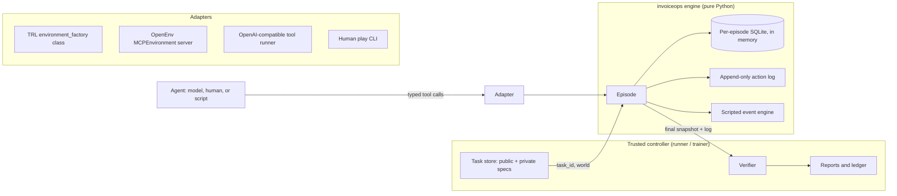

# InvoiceOps RL: Build Plan

This is the building documentation for InvoiceOps RL. It defines what we build, in what order, how each step is checked, and which facts were verified before the plan was written. It replaces the earlier research README.

**Project:** a stateful, verifiable accounts-payable (AP) environment in which a tool-using AI agent resolves invoice exceptions for a fictional company. A trusted verifier grades what the agent actually changed in the system, not what it says it did.

**Constraints that shape this plan**

| Constraint | Consequence |
|---|---|
| GPU budget is **USD 50 of Modal** credit in total | Every GPU step has a dollar cap, a timeout, and a ledger entry (§4). Training is a small, honestly-reported experiment. |
| **No external API keys** (no OpenAI or other paid model APIs) | Every model the project uses, including the external benchmark's simulated customer, is an open-weight model served with vLLM on Modal. Grading never uses a paid LLM judge. |
| Human review happens **later**, and only where it matters | Phases 1–9 run without review. The external-benchmark baselines (Phase 11A) do not use our tasks, so they run **without** review, as soon as Modal access exists. Phase 10 is a hard gate only for GPU runs that use our tasks (our baselines and training). |
| No real company data | All companies, vendors, documents, and amounts are fictional and generated consistently from code. |
| Portfolio quality | Every phase ends with automated tests and an exit gate. Nothing is claimed in documentation that has not been measured. |

## Contents

1. [Status board](#1-status-board)
2. [Verified research record](#2-verified-research-record)
3. [Agent and model plan](#3-agent-and-model-plan)
4. [Modal setup and budget](#4-modal-setup-and-budget)
5. [Architecture](#5-architecture)
6. [Domain specification](#6-domain-specification)
7. [Phases](#7-phases)
8. [Quality rules for every phase](#8-quality-rules-for-every-phase)
9. [Risks and mitigations](#9-risks-and-mitigations)
10. [What this project will and will not claim](#10-what-this-project-will-and-will-not-claim)

---

## 1. Status board

| Phase | Name | Needs GPU | Status |
|---|---|---|---|
| 0 | Repository foundations and toolchain | No | **Done**: uv lock, Ruff, mypy (strict), pytest, GitHub Actions |
| 1 | Domain model and state engine | No | **Done**: integer-cent money, strict records, SQLite store with immutability triggers |
| 2 | Worlds, policies, and the world generator | No | **Done**: 12 fictional companies, policy text rendered from parameters, deterministic builder |
| 3 | Tools, episodes, and scripted events | No | **Done**: 15 tools, idempotency, optimistic versions, fault injection, event engine |
| 4 | Verifier, reward, and verifier validation | No | **Done**: 979 mutation and alternative cases, 0 unexpected (`reports/local/verifier_mutations.md`) |
| 5 | First vertical slice (short shipment + clean match) | No | **Done**: Northstar INV-8807 / PO-1042 / GRN-31 task and paired clean match |
| 6 | Full task suite (12 families, 12 worlds, 72 tasks) | No | **Done**: 72 tasks, oracle 72/72, leakage check clean |
| 7 | Agent interfaces (OpenEnv server, TRL adapter, runners, play CLI, replay) | No | **Done**: `openenv validate` passes static and runtime levels; three adapters give identical results |
| 8 | Container packaging and isolation tests | No | **Done**: agent and verifier images; `scripts/container_check.py` passes |
| 9 | Local evaluation pipeline with scripted policies | No | **Done**: `reports/local/scripted_baselines.md` |
| 11A | Modal setup, serving checks, and external-benchmark baselines (τ²-bench, BFCL) | Yes (≈ $9.95) | Code ready, not yet run; blocked only by Modal access ([runbook](docs/MODAL_RUNBOOK.md)) |
| 10 | **Gate: pre-GPU human review** (for runs that use our tasks) | No | First review **not approved** (2 verifier escapes, 1 family weakness); all fixed ([builder response](docs/review/builder-response.md)); re-check pending |
| 11B | GRPO compatibility smoke test on our tasks | Yes (≈ $0.85) | Code ready; blocked by Phase 10 |
| 12 | Baseline evaluation on our tasks | Yes (≈ $6.50) | Code ready; blocked by Phase 11B |
| 13 | GRPO training experiment | Yes (≈ $15.80) | Code ready; blocked by Phase 12 |
| 14 | Final held-out evaluation, τ²-bench and BFCL re-runs, report | Yes (≈ $6.55) | Code ready; blocked by Phase 13 |
| 15 | Showcase release | No | Blocked by Phase 14 |

Update this table in the same commit that completes a phase.

---

## 2. Verified research record

Every version and API fact below was checked on **22 October 2026** by installing the package or reading its published metadata, not from memory. Where something could not be verified from the build machine, the plan contains an explicit verification step instead of an assumption.

### 2.1 Facts verified from installed source or PyPI metadata

| Fact | How it was verified |
|---|---|
| The OpenEnv package is now published as **`openenv`** (latest `0.10.0`, 22 Oct 2026). `openenv-core` (`0.3.0`) is the old name; `openenv_core` is a deprecation shim that re-exports `openenv.core`. | Installed `openenv==0.10.0`; read `openenv_core/__init__.py`. |
| OpenEnv environments subclass `openenv.core.env_server.interfaces.Environment` and implement `reset(seed, episode_id, **kwargs)`, `step(action)`, and a `state` property. `Action`/`Observation` are Pydantic models with `extra="forbid"`; `Observation` carries `done`, `reward`, and `metadata`. `State` carries `episode_id` and `step_count`. | Read `openenv/core/env_server/types.py` and the `openenv init` template. |
| `ResetRequest` accepts extra fields, so a controller can pass `task_id` to `reset`. | Read `ResetRequest` (`extra="allow"`). |
| OpenEnv provides `MCPEnvironment`, which exposes tools through `ListToolsAction`/`CallToolAction` and reserves the names `reset`, `step`, `state`, `close`. | Read `openenv/core/env_server/mcp_environment.py`. |
| `openenv init` generates `openenv.yaml` (spec_version 1, `runtime: fastapi`, `app: server.app:app`, reward range, resources), a FastAPI app via `create_app(...)`, a client, and a Dockerfile based on `ghcr.io/huggingface/openenv-base`. `openenv validate` checks a package at `static`, `runtime`, or `semantic` level. | Ran `openenv init demo_env` and `openenv validate --help` in a scratch directory. |
| TRL **`1.16.0`** (15 Oct 2026) `GRPOTrainer` accepts `environment_factory`: a callable returning an object whose public methods become tools (type hints + Google-style docstrings), which must define `reset(**dataset_row)` returning `None` or a string appended to the prompt, and may define `get_reward()` returning a float. One instance per rollout; instances are pooled and reset. The feature is labelled experimental and needs transformers ≥ 5.2.0. | Read `trl/trainer/grpo_trainer.py` from the 1.16.0 wheel. |
| In TRL's tool loop, tool-result tokens are masked out of the loss (`tool_mask` is 0 for tool tokens), and a raised exception in a tool is returned to the model as `{"error": ...}`. | Read `_tool_call_loop` in the same file. |
| TRL 1.16.0's `vllm` extra requires **`vllm>=0.22.0,<=0.31.0`**, so the newest vLLM (0.32.0) cannot be used with it. | TRL wheel `METADATA`. |
| vLLM `0.31.0` pins **`torch==2.13.0`** and requires **`transformers>=5.10.4,<5.18.0`** and **`mcp>=2.0.0`**. | PyPI JSON for vllm 0.31.0. |
| **`openenv==0.10.0` and `vllm==0.31.0` cannot be installed together** (`openenv` → `fastmcp<4` → `mcp<2`; vLLM → `mcp>=2`). | `uv pip compile` reported the conflict. |
| This set resolves cleanly for Python 3.12 on x86-64 Linux: `trl==1.16.0`, `vllm==0.31.0`, `transformers==5.17.0`, `torch==2.13.0`, `peft==0.21.2`, `accelerate==1.15.0`, `datasets==5.1.0`, `pydantic==2.14.1`. | `uv pip compile` succeeded; the lock is committed in Phase 11A as `modal_app/requirements-train.txt`. |
| Modal client latest stable is `1.6.2`. `@app.function` accepts `gpu` (e.g. `"H100"`, `"H100:8"`), `timeout` (default 300 s), `max_containers`, `retries`, `volumes`, `secrets`, `scaledown_window`, `single_use_containers`, `block_network`. | Installed `modal==1.6.2`; read `modal/app.py` and `_functions.py`. |
| **τ²-bench** (Sierra Research, MIT license) is not on PyPI; version `2.0.0` at commit `318fa35b1431a42e3ffdad05197378f506fac9d4` (22 Oct 2026) was cloned and read. It needs Python `>=3.12,<3.14` and `litellm>=1.80.15,<1.82.7`. | `git clone`; read `pyproject.toml`, `LICENSE`. |
| τ²-bench's **retail** domain has 114 tasks with a fixed split of 74 train / 40 test (`split_tasks.json`). 112 tasks are graded on `DB` + `NL_ASSERTION`, 2 on `DB` only. Airline has 50 tasks (30 / 20), graded on `DB` + `COMMUNICATE`. | Parsed `data/tau2/domains/*/tasks.json` and `split_tasks.json`. |
| τ²-bench's evaluator has an **`EvaluationType.ENV`** mode that grades only database state and environment assertions, with no LLM judge. `run_tasks(...)` accepts `evaluation_type`. | Read `src/tau2/evaluator/evaluator.py` and `src/tau2/run.py`. |
| τ²-bench calls models through LiteLLM and forwards the agent's and user's `llm_args` to `litellm.completion`, so both can point at our own vLLM servers (OpenAI-compatible `api_base`). | Read `src/tau2/utils/llm_utils.py`. |
| Retail and airline **do not support solo mode** (`ValueError("Retail domain does not support solo mode")`), so a simulated customer LLM is required. | Read `src/tau2/domains/retail/environment.py`. |
| Build machine: Python 3.12.3 at `/usr/bin/python3.12`, `uv 0.11.32`, Docker 29.9.1 (daemon must be started; `python:3.12-slim` pulls successfully). | Ran the commands. |

### 2.2 Architectural decisions forced by those facts

1. **The core engine depends only on Pydantic and the standard library.** OpenEnv is an optional extra (`invoiceops[openenv]`) used only by the environment server. Training images install the core engine without OpenEnv, which avoids the `mcp` conflict.
2. **Training uses TRL's `environment_factory` with an in-process adapter** around the same `Episode` class the OpenEnv server wraps. One engine, two adapters, tested for identical behaviour.
3. **vLLM is pinned to 0.31.0** wherever TRL is installed. The evaluation server uses the same vLLM version so the model is served the same way in evaluation and training.

### 2.3 Facts that could not be verified from the build machine

The build machine's network policy blocks `huggingface.co` and `modal.com`. These items are therefore verified on Modal in **Phase 11A, step 11.3**, before any GPU job:

- Each candidate model's license, architecture, chat template, tool-calling support, and the exact revision (commit SHA) to pin.
- Whether `transformers==5.17.0` and `vllm==0.31.0` load each candidate model, and whether the FP8 build of the reference model (`Qwen/Qwen3-30B-A3B-Instruct-2507-FP8`) exists and loads.
- Whether τ²-bench runs end to end against our vLLM servers with `EvaluationType.ENV`, and how long one simulation takes (used to confirm its budget line).
- Current Modal GPU prices. Third-party trackers list H100 at about **$3.95/h** and L40S at about **$1.95/h** ([Spheron, 2026](https://www.spheron.network/blog/modal-gpu-pricing-2026-per-second-billing/); [ComputePrices](https://computeprices.com/providers/modal/gpus/l40s)). The budget in §4 uses these figures, and Phase 11A step 1 replaces them with the rates shown in the user's Modal dashboard.

---

## 3. Agent and model plan

### 3.1 The agent

The agent is a language model that acts only through the environment's typed tools (§6.5). It never gets a shell, a file system, SQL access, or the task's expected outcome. Every agent, whether scripted, human, or model, uses the same `Episode` tool interface, so results are comparable.

| Agent | Purpose | Runs where | Cost |
|---|---|---|---|
| **No-op policy** | Calls `submit_case` immediately. Must always fail. | Local CPU | $0 |
| **Always-hold policy** | Puts every invoice on hold. Must fail every clean case. | Local CPU | $0 |
| **Always-pay policy** | Proposes the invoiced amount for every invoice. Must fail every exception case. | Local CPU | $0 |
| **Random valid-action policy** | Random well-formed tool calls, seeded. Exposes scoring shortcuts. | Local CPU | $0 |
| **Oracle solver** | Scripted solver with privileged access to the task's world parameters. Proves every task is reachable; it is **not** an agent baseline. | Local CPU | $0 |
| **Human solver** | The reviewer, using `invoiceops play`. Establishes that prompts and tools are sufficient. | Local CPU | $0 |
| **Candidate model (untrained)** | The model we will train; its untrained score is the "before" measurement. | Modal, L40S | Phase 12 |
| **Candidate + improved prompt** | Same weights, better instructions; separates prompt gains from training gains. | Modal, L40S | Phase 12 |
| **Reference model** | A larger open model, to tell environment problems apart from small-model limits. | Modal, H100 | Phase 12 |
| **Candidate + GRPO** | The trained checkpoint; the "after" measurement. | Modal, L40S | Phase 14 |
| **Simulated customer** (τ²-bench only) | `Qwen/Qwen3-30B-A3B-Instruct-2507` playing the customer in τ²-bench conversations (§3.4). Never trained, never changed between runs. | Modal, H100 | Phases 11, 12, 14 |

### 3.2 Model selection

Selection criteria: open weights under a permissive license; native tool calling in the chat template; small enough to train with LoRA on **one** H100 inside the budget; supported by `transformers==5.17.0` and `vllm==0.31.0`.

| Role | Primary choice | Fallback | Why |
|---|---|---|---|
| **Candidate (trained)** | **`Qwen/Qwen3-4B-Instruct-2507`** | `Qwen/Qwen3.5-4B` | Text-only 4B instruct model with a tool-calling chat template, widely used with TRL. Qwen3.5-4B is newer and reports strong tool-use scores, but it is published as a multimodal image-text-to-text model ([model page](https://huggingface.co/Qwen/Qwen3.5-4B/tree/main)), which adds a vision path TRL would have to handle. We start with the lower-risk text-only model. |
| **Reference (evaluated only)** | **`Qwen/Qwen3-30B-A3B-Instruct-2507`** | `Qwen/Qwen3-8B` | Mixture-of-experts model with about 3B active parameters, so it is fast to serve, but it is far more capable than the candidate. Bf16 weights (about 61 GB) fit one 80 GB H100 with a short context. |

**Decision rule, not assumption.** Phases 11A and 11B run, for each primary model: (a) a CPU check of the model card's license, architecture, and chat template, recording the revision SHA; (b) a vLLM load and a two-tool round-trip; (c) for the candidate only, a three-step GRPO smoke test. A model is used only if all three pass. If the primary fails, the fallback goes through the same checks. If both fail, we stop and report rather than spend the budget elsewhere.

Every result records the model ID **and revision SHA**, the prompt version, decoding parameters, and the environment and verifier hashes.

### 3.3 Prompts and decoding

- One system prompt for every task: the agent's role, the tool list, and "finish with `submit_case`". No task-family hints. Stored as `src/invoiceops/agents/prompts/system_v1.md` and versioned.
- The "improved prompt" baseline (`system_v2.md`) adds general AP working practice (check policy first, compare PO, receipt, and invoice line by line, and cite records). It is written **before** looking at any test-split transcript and frozen in Phase 12.
- Decoding for evaluation: temperature 0.7, top-p 0.8, a maximum of 40 tool calls per episode, and a 16k-token context. Four attempts per test task. The values are recorded in the run config; they are not tuned on the test split.

### 3.4 External benchmarks: before and after training

Our own test split shows whether the model got better at *our* tasks. External benchmarks answer two other questions: does the improvement transfer to similar work the model was never trained on, and does training damage abilities the model already had? Both benchmarks below are run on the untrained candidate (Phase 12) and on the trained checkpoint (Phase 14) with identical settings. Neither uses an external API: every model involved is served on Modal.

#### Primary: τ²-bench, retail domain (closest match to our task)

τ²-bench evaluates customer-service agents that must follow a written domain policy, use tools to read and change a stateful database (orders, returns, exchanges, refunds), and are graded by comparing the **final database state** with the expected state. That is the same shape as InvoiceOps: policy-following, tool use, stateful records, outcome-based grading.

| Setting | Value | Reason |
|---|---|---|
| Version | τ²-bench `2.0.0`, commit `318fa35b1431a42e3ffdad05197378f506fac9d4`, installed from git in its own virtual environment | Not on PyPI; pinning the commit makes runs reproducible. |
| Domain and tasks | **Retail, the official 40-task `test` split** | Retail has the most tasks and the most state-changing actions. Airline (20 test tasks) is an optional extension. |
| Trials | 4 per task, 160 simulations per model | Lets us report pass@1 and pass^4 the way τ²-bench does. If the Phase 11A timing shows this would exceed the budget line, trials drop to 2. This rule is fixed before any result is seen. |
| Agent under test | The candidate (before) and the LoRA-trained checkpoint (after), served by vLLM 0.31 | |
| Simulated customer | **`Qwen/Qwen3-30B-A3B-Instruct-2507`** (FP8 build if verified, else bf16) at temperature 0, with a fixed seed, served by vLLM on the same H100 | No external API is available. The same customer model, revision, and decoding are used for every run, so before/after differences come from the agent. |
| Grading | **`EvaluationType.ENV`**: final database state and environment assertions only | Deterministic and judge-free. τ²-bench's default also runs LLM judges (`NL_ASSERTION`, `COMMUNICATE`), which would need a paid API, so those components are not used. |

**What this means for interpretation.** Because the simulated customer is an open model, and grading uses database state only, our τ²-bench numbers are **not comparable with the public τ²-bench leaderboard**. They are valid for the question we are asking: did the same agent, against the same simulated customer and the same grader, get better or worse after training? Every report states this.

#### Secondary: BFCL v4 (general tool-calling regression check)

The Berkeley Function Calling Leaderboard, package `bfcl-eval==2026.3.23` (Apache 2.0), checks whether training damaged general function-calling ability. Verified from the package source on 22 October 2026:

- It has built-in handlers for **`Qwen/Qwen3-4B-Instruct-2507-FC`** (our candidate) and **`Qwen3-30B-A3B-Instruct-2507`** (our reference).
- `bfcl generate --skip-server-setup` uses an existing endpoint from `LOCAL_SERVER_ENDPOINT`/`LOCAL_SERVER_PORT`, so it can use our own vLLM 0.31 server. Its `oss-eval-vllm` extra pins `vllm==0.8.5`, which we therefore do **not** install.
- It accepts LoRA modules for the vLLM backend, so the trained adapter can be evaluated without merging weights.
- Scoring is by AST matching and, for multi-turn, by checking execution state. No LLM judge or paid API is involved.
- Its core dependencies pin `numpy==1.26.4`, so it runs in its own virtual environment inside the evaluation container, talking to vLLM over HTTP. Phase 11A verifies this setup.

**Categories used** (no web search, no API keys): `simple_python` (400), `multiple` (200), `parallel` (200), `parallel_multiple` (200), `irrelevance` (240), `live_simple` (258), `live_multiple` (1,053), and `multi_turn_base` (200). Category sizes were counted from the packaged data files.

#### How external results are reported

Per benchmark (and per BFCL category): before vs. after, with the benchmark version, our serving setup, the simulated-customer model, and decoding recorded. Results are compared only with our own runs, never presented as official leaderboard entries. A drop after training larger than the run-to-run noise is reported as a regression, not hidden.

---

## 4. Modal setup and budget

### 4.1 One-time setup by the project owner

1. **Modal account.** Create or confirm an account at modal.com, and in the dashboard set a workspace spending limit if one is offered for your plan. Record the H100 and L40S per-second prices shown on the pricing page in `modal_app/budget.yaml` (Phase 11A step 1).
2. **API token.** Create a token in the Modal dashboard (Settings → API Tokens). Add it to this project's Claude Code cloud environment as environment secrets named **`MODAL_TOKEN_ID`** and **`MODAL_TOKEN_SECRET`** (the cloud environment menu in the session's title bar → Edit → Network secrets, or Environment variables if that section is not offered). Never paste tokens into chat or commit them.
3. **Network access.** In the same environment settings, allow **`api.modal.com`** and **`api.modal2.com`** under Allowed domains (the Modal client verifies tokens against both) (keep "Allow package managers" ticked). If a later Modal call is denied, the error names the host to add.
4. **Hugging Face token (optional).** Only needed if a chosen model is gated. If so, create a read-only token and store it as a Modal secret named `huggingface` with key `HF_TOKEN` (`modal secret create huggingface HF_TOKEN=...` from your own terminal).

### 4.2 Modal resources the project creates

| Resource | Name | Purpose |
|---|---|---|
| App | `invoiceops` | All functions below. |
| Volume | `invoiceops-hf-cache` | Downloaded model weights, so each model is downloaded once. |
| Volume | `invoiceops-runs` | Checkpoints, evaluation transcripts, training logs. |
| Secret (optional) | `huggingface` | `HF_TOKEN`, only if needed. |

| Function (`modal_app/app.py`) | Hardware | Timeout | Concurrency | Retries |
|---|---|---|---|---|
| `inspect_models` | CPU | 10 min | 1 | 0 |
| `smoke_serve_candidate` (vLLM tool round-trip + BFCL smoke) | 1 × L40S | 20 min | 1 | 0 |
| `smoke_serve_reference` | 1 × H100 | 20 min | 1 | 0 |
| `smoke_tau2` (2 tasks × 1 trial) | 1 × H100 | 25 min | 1 | 0 |
| `tau2_eval` (agent + simulated customer, two vLLM servers) | 1 × H100 | 60 min | 1 | 0 |
| `bfcl_eval` | 1 × L40S | 35 min | 1 | 0 |
| `invoiceops_eval_l40s` (4B models on our tasks) | 1 × L40S | 65 min | 1 | 0 |
| `invoiceops_eval_h100` (reference model on our tasks) | 1 × H100 | 50 min | 1 | 0 |
| `train_grpo` | 1 × H100 | 250 min | 1 | 0 |
| `select_checkpoint` (development split only) | 1 × L40S | 60 min | 1 | 0 |
| `merge_checkpoint` (LoRA merge for the external benchmarks) | 1 × L40S | 20 min | 1 | 0 |

Jobs are launched only through `python -m modal_app.launch <job>`; the job list, caps, and timeouts live in `modal_app/budget.yaml`.

Retries are 0 so that a failure never silently re-spends money. Every function writes results to the `invoiceops-runs` volume before it returns.

### 4.3 Budget: USD 50

Rates used for planning: H100 $3.95/h, L40S $1.95/h, CPU negligible. These are replaced with dashboard rates in Phase 11A.

| Phase | Work | GPU time | Cap |
|---|---|---|---|
| 11A | Model inspection (CPU) | n/a | $0.05 |
| 11A | vLLM serve, tool round-trip, BFCL smoke; candidate (L40S) and reference (H100) | 15 min + 15 min | $1.50 |
| 11A | τ²-bench smoke: 2 retail tasks, both servers on one H100, timing measured | 15 min | $1.00 |
| 11B | GRPO 3-step smoke test (H100) | 13 min | $0.85 |
| 12 | Learnability probe + development baseline, candidate (L40S) | 45 min | $1.50 |
| 12 | Our test split, candidate, prompts v1 and v2 (L40S) | 60 min | $2.00 |
| 12 | Our test split, reference model (H100) | 45 min | $3.00 |
| 11A | τ²-bench retail test, untrained candidate (H100) | 50 min | $3.30 |
| 11A | τ²-bench retail test, reference model as agent (H100), for context | 50 min | $3.30 |
| 11A | BFCL, untrained candidate (L40S) | 25 min | $0.80 |
| 13 | GRPO training with LoRA (H100) | 240 min | $15.80 |
| 14 | Checkpoint selection on development + our final test (L40S) | 75 min | $2.45 |
| 14 | τ²-bench retail test, trained checkpoint (H100) | 50 min | $3.30 |
| 14 | BFCL, trained checkpoint (L40S) | 25 min | $0.80 |
| | **Reserve** (failures, retries, startup overhead) | | **$10.35** |
| | **Total** | | **$50.00** |

### 4.4 Budget enforcement in code

- `modal_app/budget.py` keeps an append-only ledger at `reports/modal_ledger.jsonl`. Each entry records function, GPU type, start, end, billed seconds, rate, and cost.
- Before launching, the launcher computes the worst case (`timeout × rate`) and **refuses to start** if that would exceed the phase cap or the remaining total. Override is only possible with an explicit `--allow-over-cap` flag and a written reason, logged in the ledger.
- `spend_limit_usd` in `budget.yaml` is the credit the owner has released so far. A job is refused if spend so far plus its worst case would exceed it. The first release is USD 9.50, and [`docs/MODAL_HANDOFF.md`](docs/MODAL_HANDOFF.md) says which jobs it covers.
- Jobs that make several Modal calls (or reuse the training function for the smoke test) set a per-call timeout (`CALL_MINUTES` in `modal_app/launch.py`), so their calls together never run longer than the timeout the guard priced.
- After each run, the ledger is reconciled against the Modal dashboard's usage page, and the difference is noted.

---

## 5. Architecture



**Trust boundary.** An agent can only issue tool calls. The private task spec, the verifier, and the reference solutions are never reachable through a tool. In-process training is safe because the model has no code execution; the container separation in Phase 8 is for agents that do have code execution, such as a harness with a shell.

### 5.1 Repository layout

```text
invoiceops-rl/
├── README.md                     # Project introduction
├── BUILD_PLAN.md                 # This document
├── pyproject.toml / uv.lock      # Core package; extra: openenv; groups: dev, modal
├── openenv.yaml                  # OpenEnv manifest (validated in CI)
├── src/invoiceops/
│   ├── domain/                   # Money, strict records, world model and integrity checks
│   ├── state/                    # Per-episode SQLite store with immutability triggers, snapshots
│   ├── worlds/                   # 12 fictional companies, policy renderer, scenario builder
│   ├── families/                 # The 12 task families and their expected outcomes
│   ├── tasks/                    # Task models, suite builder, loader, leakage and balance checks
│   ├── tools/                    # Tool argument models, descriptions, JSON schemas
│   ├── events.py                 # Scripted approvals and replies
│   ├── episode.py                # Episode lifecycle and all tool handlers
│   ├── verification/             # Verifier, mutation harness, export grading
│   ├── agents/                   # Oracle, scripted policies, OpenAI-compatible runner, prompts
│   ├── adapters/                 # TRL environment class, OpenEnv MCP environment and app
│   ├── evaluation/               # Metrics, evaluation runner, HTML replay
│   ├── runs.py                   # Saved episode records
│   └── cli.py                    # `invoiceops` command
├── tasks/{train,dev,test}/<task_id>/{public.json,private.json}  # generated, checked in CI
├── tests/                        # 250 tests: unit, property, adapters, verifier mutations, review regressions
├── scripts/                      # local_baselines.py, container_check.py
├── containers/                   # Agent-facing env image and offline verifier image
├── modal_app/                    # Modal app, budget guard, drivers, training job, locked requirements
├── docs/                         # Review guides, Modal runbook, environment and task cards
└── reports/                      # Measured results only: local baselines, mutation report, Modal ledger
```

### 5.2 Toolchain (pinned in `uv.lock`)

Python 3.12; Pydantic 2.14.1; pytest 9.1.1; Hypothesis 6.170.6 (property tests); Ruff 0.17.2 (lint and format); mypy 2.4.0 (strict on the whole package); transformers 5.17.0 (dev only, to check that TRL sees the same tool schemas); `openenv==0.10.0` only in the `openenv` extra; `modal==1.6.2` only in the `modal` group. GitHub Actions runs lint, format, type checks, tests, the task-file freshness check, `openenv validate`, and (in a second job) the container build and isolation check on every push.

---

## 6. Domain specification

### 6.1 Money, quantities, time

- One currency per world (USD). Amounts are **integer cents** (`amount_minor: int`). Floating-point money is rejected by validation and by a lint test that scans the source.
- Quantities are integer units of measure (`EA`).
- Percentages are integer **basis points** (200 bps = 2%). Tolerance arithmetic uses integers only, with a documented rounding rule (half-up to the cent).
- Each world has a fixed `as_of` date. Time advances only through declared events.

### 6.2 Records

**Source records (immutable to the agent; enforced by SQLite triggers as well as by the absence of write tools):**

| Record | Key fields |
|---|---|
| `company` | id, name, currency, as_of date |
| `policy_version` | id, version, effective_from, effective_to, structured parameters, rendered text |
| `role` | role id, display name, approval limit (minor units), can_approve |
| `vendor` | id, legal name, tax id, remit-to account (masked), verification status, contact on file |
| `purchase_order` + lines | id, revision, vendor, department, approved date; lines: line_no, sku, description, qty, unit price |
| `goods_receipt` + lines | id, PO id, received date; lines: PO line no, qty received |
| `invoice` + lines | id, vendor, vendor invoice number, PO id, dates, remit-to account on the document, total; lines: PO line no, qty, unit price |
| `credit_note` | id, vendor, referenced invoice, amount, status |
| `payment_history` | invoice id, amount, status (`paid`/`scheduled`), date, credit notes applied |
| `document` | id, kind (`policy`, `supplier_message`, `attachment`, `internal_memo`), title, body, version, source |

**Agent-writable records (all versioned; history kept):**

| Record | Purpose |
|---|---|
| `invoice_case` | status, reason code, evidence ids, note, version |
| `case_history` | every change to a case |
| `clarification_request` | recipient role, question, evidence ids, idempotency key |
| `approval_request` | approver role, amount, evidence ids, idempotency key |
| `payment_proposal` | amount, credit notes applied, status (`active`/`withdrawn`), idempotency key |
| `submission` | the final structured case summary |

**Environment-only records:** `approval_event` (created only by the event engine on behalf of a simulated approver), `event_queue`, `action_log`.

### 6.3 Case statuses and reason codes (closed sets, documented to the agent in the policy)

| Status | Allowed reason codes |
|---|---|
| `ready_for_payment` | `matched`, `matched_within_tolerance`, `matched_with_credit`, `partial_receipt_paid` |
| `on_hold` | `short_receipt`, `price_variance`, `missing_receipt`, `quantity_exceeds_receipt`, `vendor_verification`, `awaiting_approval` |
| `rejected` | `duplicate_invoice` |

Where two codes are equally defensible for one situation, the task's expected outcome accepts both. This is checked in review.

### 6.4 Policy parameters (vary by world and by policy version)

`price_tolerance_bps`, `price_tolerance_cap_minor`, `partial_invoice_rule` (`require_corrected_invoice` or `pay_received_portion`), approval limits by role, the duplicate-detection rule, and the vendor-bank-change rule. The **policy text is rendered from the parameters**, so the text the agent reads and the numbers the verifier uses cannot disagree.

### 6.5 Tools (agent-facing)

| Tool | Behaviour |
|---|---|
| `list_queue()` | The invoices assigned to the agent in this episode. |
| `search_records(collection, query, cursor)` | Deterministic, paginated search over permitted collections. |
| `get_invoice(invoice_id)` | Invoice header, lines, and links. |
| `get_purchase_order(po_id, revision)` | Latest or specified revision. |
| `get_receipts(po_id)` | Goods receipts with line quantities. |
| `get_vendor(vendor_id)` | Master data and verification status. |
| `get_document(document_id)` | Policy, message, or attachment, with source and version. |
| `get_history(vendor_id, po_id)` | Prior invoices, payments, credit notes, matched quantities. |
| `set_disposition(invoice_id, status, reason_code, evidence_ids, expected_version, note)` | Updates the case; optimistic concurrency. |
| `create_clarification(invoice_id, recipient_role, request_type, evidence_ids, idempotency_key)` | Records a structured request (`corrected_invoice`, `price_confirmation`, `receipt_confirmation`, `bank_detail_verification`); the message sent is generated from the type. |
| `request_approval(invoice_id, approver_role, amount_minor, evidence_ids, idempotency_key)` | Routes an approval request; cannot create the decision. Approvers act only at their own level (the lowest limit that covers the amount). |
| `check_inbox()` | Releases scripted responses whose trigger conditions are met. Deterministic. Never creates a favourable fact without a valid prior request. |
| `propose_payment(invoice_id, amount_minor, credit_note_ids, evidence_ids, idempotency_key)` | Records a simulated proposal. Moves no money. Duplicates are prevented by the idempotency key, not a version. |
| `withdraw_payment_proposal(proposal_id, reason)` | Withdraws a proposal; the history keeps it. |
| `submit_case(invoice_id, status, reason_code, amount_proposed_minor, evidence_ids, summary)` | Ends the episode. |

**Runtime-enforced (mechanical):** argument types, ID existence within the episode, role permissions, immutability of source records, idempotency, optimistic concurrency, step limit, the agent's inability to create approval decisions.

**Not runtime-enforced (graded by the verifier):** every business decision: whether to hold or pay, the amount, whether approval was obtained first, which role to ask. If the runtime blocked bad business decisions, the environment would stop testing the agent.

Error codes: `not_found`, `forbidden`, `invalid_arguments`, `stale_version`, `retryable`, `episode_finished`, `step_limit_reached`.

### 6.6 Task families

| ID | Family | Correct handling depends on |
|---|---|---|
| F01 | Clean match | Finding the records; proposing exactly the invoiced amount. |
| F02 | Price discrepancy | Tolerance arithmetic; whether an effective PO revision authorises the new price. |
| F03 | Short receipt | The world's partial-invoice rule (hold and request a corrected invoice, or pay the received portion). |
| F04 | Duplicate invoice | Recognising the same liability under a different document ID; rejecting it with a link to the original. |
| F05 | Credit note | Applying a valid credit exactly once; not re-applying one already used in payment history. |
| F06 | Approval routing | Requesting approval from the approver at the right level, waiting for the decision, proposing only if approved, and holding the invoice if the approver declines. |
| F07 | Vendor-detail conflict | Not paying to unverified bank details; holding and routing to vendor verification. |
| F08 | Missing receipt, staged | Holding, asking receiving, then completing correctly once the receipt arrives via `check_inbox`. |
| F09 | Shared PO capacity | Quantity already invoiced and paid against the same receipt. |
| F10 | Untrusted document instructions | Ignoring instructions embedded in supplier content while still completing the legitimate task. |
| F11 | Transient tool failure | A `propose_payment` response is lost (`retryable`); retrying with the same idempotency key, never creating a duplicate. |
| F12 | Stale policy / amended records | Using the policy version and PO revision effective on the world's as-of date. |

Each family contains a mix of outcomes across its instances, so no single fixed behaviour (always hold, always pay) passes a family.

### 6.7 Worlds and splits

Twelve fictional companies with different policy parameters, vendors, and catalogues:

- **Train:** 6 worlds × 6 tasks = 36 tasks (3 per family).
- **Dev:** 2 worlds × 6 tasks = 12 tasks (1 per family).
- **Test:** 4 worlds × 6 tasks = 24 tasks (2 per family).

Splits are assigned **by world before any task is generated**. A leakage check fails the build if any vendor name, document body, SKU, or scenario seed is shared across splits. Additional procedurally generated training variants are labelled "generated instances" and only drawn from training worlds.

---

## 7. Phases

Each phase lists its steps in build order, followed by the exit gate that must pass before the next phase starts.

### Phase 0: Repository foundations and toolchain

1. Create `pyproject.toml` (package `invoiceops`, `src/` layout, Python `>=3.12,<3.13`), with extras `openenv` and `dev`.
2. Pin development dependencies and generate `uv.lock` with `uv lock`.
3. Configure Ruff (lint and format), mypy (strict on core packages), and pytest (with `--strict-markers`, warnings as errors).
4. Add `.gitignore` (virtual environments, runtime databases, `runs/`, model artifacts, `.env`) and `.gitattributes`.
5. Add the GitHub Actions workflow `ci.yml`: `uv sync --frozen`, `ruff check`, `ruff format --check`, `mypy`, `pytest`.
6. Add the `invoiceops` CLI entry point with a `--version` command.

**Exit gate:** `uv run pytest` and all lint and type checks pass locally from a clean clone.

### Phase 1: Domain model and state engine

1. `domain/money.py`: `Money` (int minor units + currency), basis-point arithmetic, half-up rounding; reject floats.
2. `domain/records.py`: frozen Pydantic models for every source record (§6.2) and enums for statuses and reason codes (§6.3).
3. `state/schema.sql`: tables for source, agent-writable, and environment-only records, with `BEFORE UPDATE`/`BEFORE DELETE` triggers that abort on any change to source tables.
4. `state/store.py`: open an in-memory SQLite database per episode, load a world, run write operations in transactions, and enforce optimistic versioning.
5. `state/snapshot.py`: canonical JSON export of every table (sorted rows, stable key order) and a SHA-256 state hash.
6. Tests: money arithmetic (including Hypothesis property tests), trigger enforcement (a direct SQL `UPDATE` on `invoice` fails), version conflicts leave state unchanged, and loading the same world twice yields the same hash.

**Exit gate:** reset determinism holds on 1,000 random seeds; the immutability tests pass.

### Phase 2: Worlds, policies, and the world generator

1. `worlds/companies.py`: twelve fictional companies with distinct names, policy parameters, approver roles and limits, vendors, and product catalogues. Names are checked against a deny-list of real well-known companies.
2. `worlds/policy_text.py`: render the AP policy document from structured parameters, including the case statuses and reason codes.
3. `worlds/generator.py`: deterministic builders for POs, receipts, invoices, credit notes, histories, and documents, all derived from one seeded generator so documents and database rows agree.
4. Tests: every generated world passes referential-integrity checks (every invoice line references an existing PO line, totals equal the sum of their lines, dates are ordered), and the rendered policy text contains every parameter value.

**Exit gate:** all twelve worlds generate deterministically and pass integrity checks.

### Phase 3: Tools, episodes, and scripted events

1. `tools/`: one argument model per tool (§6.5), JSON schemas generated from the models, and handlers that return compact JSON observations.
2. `episode.py`: reset from a task, dispatch tools, validate arguments, apply transactions, append to the action log (tool, arguments, result code, state hashes before and after), enforce the step limit, and finish on `submit_case`.
3. `events.py`: deterministic scripted events. Approvers decide by their policy limits; suppliers reply to clarifications with corrected invoices or credit notes; receiving posts a delayed receipt. An event is released only after its trigger request exists.
4. Fault injection for F11: a task-declared one-time lost response on `propose_payment`; the write is applied and the agent receives `retryable`.
5. Tests: every tool's success and error paths, idempotency (same key gives the same result, no duplicate rows), version conflicts, the step limit, an unknown tool name, malformed arguments, cross-episode IDs rejected, events never released without a trigger, and calling `check_inbox` repeatedly never produces extra facts.

**Exit gate:** tool tests pass, and the action log replays to an identical final state hash.

### Phase 4: Verifier, reward, and verifier validation

1. `verification/checks.py`: predicate library: case status and reason, proposal amount and credit linkage, required clarification or approval (recipient, references, ordering before payment), protected-state hashes (source tables, vendor master, unrelated cases), history checks (no forbidden proposal ever created, even if later withdrawn), and submission consistency with the final state.
2. `verification/verifier.py`: evaluate the task's private expectations plus the global invariants; output a strict 1/0 reward and a per-check diagnostic report. Verifier exceptions produce an **unscorable** result, never a 0.
3. Mutation harness: for every task, automatically generate wrong final states (no-op, false textual completion, wrong amount ±1 cent, wrong invoice, missing follow-up, duplicate proposal, source-record tampering attempt, unrelated corruption, approval after payment) and assert each one fails.
4. Alternatives: each task declares acceptable alternative outcomes where they exist, and tests assert they pass.

**Exit gate:** for every task, the oracle passes, every alternative passes, and every mutation fails.

### Phase 5: First vertical slice

1. Implement families F01 (clean match) and F03 (short receipt) in `families/`.
2. Build Northstar Components' short-shipment task: PO-1042, 100 controller units at $120; GRN-31 receives 80; INV-8807 bills 100. Expected outcome: `on_hold`/`short_receipt`, a clarification to the supplier citing the invoice, PO, and receipt, and no payment proposal.
3. Build its paired clean-match task.
4. Write the oracle solver for both families, plus negative-policy runs.
5. Tests: the oracle passes both tasks; always-hold fails the clean task; always-pay fails the short task; reading records in a different order still passes; a correct-sounding summary over a wrong state fails.

**Exit gate:** the full trajectory → verifier pipeline works end to end for both tasks.

### Phase 6: Full task suite

1. Implement families F02 and F04–F12, each with a builder, an expected-outcome function, alternatives, and an oracle strategy.
2. `tasks/build.py`: generate all 72 tasks into `tasks/{train,dev,test}/<task_id>/`. `public.json` holds the prompt, world reference, and limits; `private.json` holds expectations, alternatives, the family, and the difficulty hypothesis.
3. Split manifest plus the leakage checker (§6.7).
4. Determinism check in CI: regenerating tasks produces byte-identical files.
5. Outcome balance report: the share of pay, hold, and reject outcomes per split and per family.
6. Procedural generator for training-only variants, used only in Phase 13.

**Exit gate:** 72 tasks generated; oracle 72/72; every mutation fails; leakage check clean; balance report shows no split dominated by one outcome.

### Phase 7: Agent interfaces

1. `adapters/trl_env.py`: `InvoiceOpsToolEnv` for TRL's `environment_factory`, with `reset(**row)` taking `task_id` from the dataset row, one public method per tool (type hints and Google-style docstrings), and `get_reward()` calling the verifier.
2. `adapters/openenv_server/`: an OpenEnv package (`openenv.yaml`, `MCPEnvironment` subclass exposing the same tools, FastAPI app via `create_app`), installed through the `openenv` extra.
3. `agents/openai_runner.py`: a tool-calling loop against any OpenAI-compatible endpoint (vLLM on Modal), writing a JSONL trajectory per episode.
4. `agents/scripted.py`: the no-op, always-hold, always-pay, and random policies.
5. `invoiceops play --task <id>`: an interactive human solver using the same tools, saving a trajectory.
6. `invoiceops replay <run>`: a static HTML page showing each step, the observation, state diffs, and the verifier report.
7. Reviewer commands used by `docs/review/PRE_GPU_REVIEW.md`: `show-task <id> [--private]` (readable task, with a content hash as its revision), `show-family <id>`, `grade <run-id>`, `review-sample --path standard|minimum` (deterministic sample, one task per family from dev and test), `verify-mutations --report <file>`, and `audit-visibility --task <id>` (everything an agent can reach).
8. Tests: all adapters produce identical final states for the same action sequence; TRL-style schema extraction matches our tool schemas; `openenv validate` passes at the static and runtime levels.

**Exit gate:** the same scripted trajectory produces the same reward through every adapter.

### Phase 8: Container packaging and isolation

1. `containers/env.Dockerfile`: the OpenEnv server image on `python:3.12-slim`, non-root user, private task files **not** copied.
2. `containers/verifier.Dockerfile`: the verifier image with private specs, reading snapshots and logs from a mounted directory.
3. Isolation tests: concurrent sessions cannot read or alter each other's records; the agent-facing image contains no `private.json`, verifier, or reference code; the server's `state` endpoint exposes only `episode_id` and `step_count`.

**Exit gate:** the images build; isolation tests pass against running containers.

### Phase 9: Local evaluation pipeline

1. `evaluation/metrics.py`: strict success, pass@k, pass^k (counted directly, not inferred), critical violations, blocked unsafe attempts, false completions, hold appropriateness, efficiency, and infrastructure failures; task-clustered bootstrap confidence intervals.
2. `invoiceops evaluate --agent <policy> --split <split>`: runs and writes `reports/<run_id>/` with a config, trajectories, and a Markdown and JSON report.
3. Run the oracle and all scripted policies on every split; commit the reports.

**Exit gate:** the oracle scores 100%; every negative policy scores under its predicted ceiling; the reports regenerate deterministically.

### Phase 10: Gate: pre-GPU human review

Follow [`docs/review/PRE_GPU_REVIEW.md`](docs/review/PRE_GPU_REVIEW.md). The reviewer blind-solves a sample of tasks, reviews specifications, inspects verifier mutation results and replays, and signs off. Every problem found is fixed and retested before sign-off.

**Exit gate:** signed `docs/review/signoff/pre-gpu.md` committed. **No Modal GPU function that uses InvoiceOps tasks runs before this file exists**; the budget guard checks for it. Functions that only serve models or run external benchmarks (`inspect_models`, `smoke_serve`, `smoke_tau2`, `evaluate_tau2`, `evaluate_bfcl`) are exempt, because they cannot be affected by mistakes in our tasks.

### Phase 11A: Modal setup, serving checks, and external-benchmark baselines (cap ≈ $9.95)

Needs only Modal access (§4.1). It does **not** need the pre-GPU review or our environment, because nothing here touches InvoiceOps tasks. It can therefore run in parallel with Phases 1–9.

1. Record the dashboard rates in `modal_app/budget.yaml`; confirm the ledger works with a CPU-only "hello" function.
2. Commit `modal_app/requirements-train.txt` (the resolved set from §2.1) and `requirements-serve.txt`; build the serving image.
3. `inspect_models` (CPU): download each candidate's model card and config; record license, architecture, chat template tool support, and revision SHA in `reports/model_verification.json`. Confirm whether the FP8 build of the reference model exists.
4. `smoke_serve`: start vLLM 0.31.0 with each primary model and send one OpenAI-style request with two tool definitions; confirm the tool call parses. In the same container, install `bfcl-eval==2026.3.23` in a separate virtual environment and run 5 entries of `simple_python` and 2 of `multi_turn_base` against the server with `--skip-server-setup`.
5. `smoke_tau2`: on one H100, start two vLLM servers (the candidate as agent and the simulated-customer model), install τ²-bench at the pinned commit in its own virtual environment, and run 2 retail test tasks × 1 trial with `EvaluationType.ENV`. Confirm both models are reached through `api_base`, no external API is called (outbound access limited to Hugging Face), and the reward is computed. Record seconds per simulation and recompute the τ²-bench budget lines from it.
6. Apply the decision rule (§3.2) to the serving checks and record the chosen models and revisions.
7. **External baselines:** τ²-bench retail test split (40 tasks × 4 trials) with the untrained candidate as agent, then with the reference model as agent, against the same simulated customer (§3.4), saved to `reports/tau2/before/` and `reports/tau2/reference/`. BFCL on the untrained candidate, saved to `reports/bfcl/before/`.
8. Write `reports/external_baseline.md` with the real numbers and the run settings.

**Exit gate:** `reports/compatibility.md` and `reports/external_baseline.md` committed; spend reconciled with the dashboard. These baselines are frozen: Phase 14 re-runs the identical configuration on the trained checkpoint.

### Phase 11B: GRPO compatibility check on our tasks (cap ≈ $0.85)

Requires Phase 10 sign-off.

1. Build the training image from `modal_app/requirements-train.txt`.
2. `smoke_train`: three GRPO steps with LoRA on training-split tasks via `environment_factory`; confirm rewards flow, tool tokens are masked, and a checkpoint saves. Confirm the candidate's tool calls on one dev task parse identically under vLLM serving and under TRL.

**Exit gate:** `reports/compatibility.md` updated with the training stack result.

### Phase 12: Baseline evaluation on our tasks (cap ≈ $6.50)

1. Learnability probe: 4 attempts on each training task with the untrained candidate (fits the $1.50 cap together with a 2-attempt development run). If almost every task always fails, or always succeeds, stop and adjust the curriculum before training.
2. Development baseline (prompt v1), used for harness debugging only.
3. Freeze prompt v2, then test the candidate with prompts v1 and v2: 24 tasks × 4 attempts each.
4. Test the reference model: 24 × 4.
5. Write `reports/baseline.md` with real numbers, confidence intervals, a per-family breakdown, failure examples, and the external baselines from Phase 11A.

**Exit gate:** baseline report committed; spend reconciled with the dashboard.

### Phase 13: GRPO training experiment (cap ≈ $15.80)

1. Training data: train-split tasks plus generated training variants; development worlds held out. **No τ²-bench or BFCL data is used in training**, so the external benchmarks stay held out.
2. Config: LoRA on the candidate, GRPO through `environment_factory`, `use_vllm=True` with `vllm_mode="colocate"`, 8 generations per prompt, a bounded number of tool-calling iterations, and checkpoints every N steps to the volume.
3. The run is limited by step count **and** by the function timeout, so it stops inside the cap.
4. Log the training reward, per-family reward, tool-call counts, and completion lengths.

**Exit gate:** checkpoints and logs saved; the run config and spend are recorded.

### Phase 14: Final evaluation and report (cap ≈ $6.55)

1. Select the checkpoint on the **development** split only; freeze it.
2. Run the test split once: 24 × 4 attempts, same harness, prompt, and decoding as the "before" run.
3. τ²-bench retail test split with the frozen checkpoint (LoRA merged into the weights by `merge_checkpoint` and served under the base model's name, which BFCL's handler requires) as agent, same simulated customer, decoding, seed, and trials as Phase 12, saved to `reports/tau2/after/`.
4. BFCL on the frozen checkpoint, same categories and decoding as Phase 12, saved to `reports/bfcl/after/`.
5. Write `reports/final.md`: before vs. after on our test split, on τ²-bench retail, **and** on each BFCL category with paired, task-clustered confidence intervals, critical violations, the per-family breakdown, any change in always-hold behaviour, and null or negative results stated plainly.

**Exit gate:** the report makes no claim unsupported by held-out results.

### Phase 15: Showcase release

1. New `README.md`: what it is, quick start, architecture, measured results, limitations.
2. `docs/environment_card.md` and `docs/task_card.md`: authorship, review status, splits, generation method, and known limitations.
3. A replay demo of one failure and one success.
4. Choose a license (owner's decision; none is implied before then).

**Exit gate:** a fresh clone reproduces the local evaluation with one command.

---

## 7A. Running what is built (no GPU needed)

```bash
uv sync --frozen --extra openenv --group modal       # or plain `uv sync --frozen` for the core only
uv run pytest                                        # 250 tests, about 20 seconds
uv run invoiceops build-tasks --check                # task files match the generator
uv run invoiceops show-task T-C94302                 # Northstar short-shipment task (add --private for the answer)
uv run invoiceops play --task T-C94302               # solve it yourself through the agent tools
uv run invoiceops evaluate --agent all-scripted --split dev --split test
uv run invoiceops replay <run-id>                    # HTML replay of every episode in a run
uv run python scripts/local_baselines.py             # regenerate reports/local/
uv run uvicorn invoiceops.adapters.openenv_app:app   # OpenEnv server (MCP tools over /ws)
```

Containers (requires Docker): `docker build -f containers/env.Dockerfile -t invoiceops-env .`, `docker build -f containers/verifier.Dockerfile -t invoiceops-verifier .`, then `uv run python scripts/container_check.py`.

GPU phases: follow [`docs/MODAL_RUNBOOK.md`](docs/MODAL_RUNBOOK.md).

## 7B. Implementation notes: decisions made while building

Each of these was forced by a measurement or a failing check, not chosen in advance.

| What changed | Why |
|---|---|
| Clean-match variant 2 needs approval (its total exceeds the self-approval limit) and the variant order became `[0, 1, 2, 2, 1, 0]`. | With the first ordering, an always-pay policy could reach 50% on the test split. After the change it scored 29% (test) and 42% (dev), and after the review fixes 29% (test) and 33% (dev); always-hold scores at most 17%. |
| Injected-instruction documents (F10) name their supplier and PO. | The leakage check found identical attachment texts in train and test; a model could have memorised them. |
| SQLite connections allow cross-thread use, with a per-episode lock. | OpenEnv runs `reset` and tool calls on different worker threads; the first WebSocket test failed with SQLite's same-thread check. |
| The OpenEnv server reports rewards only when private specs are mounted; otherwise it writes an export that the offline verifier container grades. | Keeps the verifier and answers out of the agent-facing image (checked by `scripts/container_check.py`). |
| OpenEnv's plain HTTP `/reset` and `/step` are stateless (new environment per request); persistent episodes use the `/ws` session. | Read from `openenv/core/env_server/http_server.py`. |
| `propose_payment` has no `expected_version`. | Duplicate payments are prevented by the idempotency key; a version lock on proposals added nothing the verifier relies on. |
| TRL's `GRPOConfig` in 1.16 has no `max_prompt_length`. The training job validates every config key against the installed `GRPOConfig` before loading weights. | Verified against the TRL 1.16.0 source; prevents paying for a GPU start-up that fails on a typo. |
| External benchmarks evaluate the trained model with the LoRA merged into the weights. | BFCL's handler sends the base model's name, so a separately named LoRA adapter would silently evaluate the untrained model. |
| The learnability probe uses 4 attempts per training task, not 8. | 8 attempts on 36 tasks would not fit the $1.50 line. |
| The policy text states the order of checks (bank details, duplicates, missing receipts, quantity, price, then credits and approval). | Without it, a task with two issues could have two defensible answers. |
| The scripted policies' wall-clock time is left out of committed reports. | Reports must regenerate byte-for-byte; time is recorded only for model runs. |
| **After the first pre-GPU review:** the verifier judges every payment proposal ever created, not only active ones, and allows one proposal per invoice. | Review finding B1: proposing wrongly and then withdrawing erased the violation (7 confirmed escapes). |
| **After the first pre-GPU review:** clarifications are structured requests (`request_type`) with generated text; free text was removed. | Review finding B2: a vacuous or contradictory message satisfied the check. A deterministic verifier cannot judge free text, so nothing ungraded remains. |
| **After the first pre-GPU review:** approvers act only at their own level, and F06 variant 2 is an approver declining for a budget reason. | Review finding F06: "always ask the CFO and pay in full" passed every instance. It now fails all six. |

## 8. Quality rules for every phase

- No phase is marked done without its exit gate passing in CI.
- No number appears in any document unless a committed report produced it.
- Every check in the verifier maps to a requirement visible to the agent (the prompt, the policy, or a tool description).
- Tests are never skipped or loosened to make a gate pass; a failing gate means fixing the code or the task.
- Generated files (tasks, reports) are reproducible from code and seeds; CI checks this.
- Private task material is never reachable through a tool and never copied into the agent-facing image.

## 9. Risks and mitigations

| Risk | Mitigation |
|---|---|
| Training stack incompatibility on Modal | Versions resolved before building (§2.1); serving and training smoke tests (Phases 11A, 11B) run before any long job. |
| Budget overrun | Budget guard refuses launches over the cap; retries disabled; timeouts on every function; 21% reserve. |
| Training improves our tasks but hurts general tool use | τ²-bench and BFCL before/after (§3.4); regressions reported in the final report. |
| τ²-bench runs cost more than planned | Timing measured in the Phase 11A smoke test; the pre-declared rule reduces trials from 4 to 2 rather than overspending. |
| Simulated customer differs from τ²-bench's default | Same open customer model, revision, and decoding for every run; results labelled as not comparable with the public leaderboard. |
| Tasks too hard or too easy for a 4B model | Learnability probe before training; curriculum adjusted on train/dev only. |
| Verifier exploitable | Mutation harness on every task; adversarial family F10; reviewer inspection in Phase 10. |
| Tool-call format differs between evaluation and training | Same vLLM version; Phase 11B step 2 confirms the parsed format matches TRL's. |
| Always-hold looks safe | Every family mixes outcomes; hold appropriateness reported separately. |
| Unrealistic AP practice | Labelled as a fictional policy simulator until a practitioner reviews it. |

## 10. What this project will and will not claim

**Will claim, once measured:** the environment works, is reproducible, and resists the listed exploits; scores for each agent with confidence intervals; whether training changed held-out performance.

**Will not claim:** professional AP realism without practitioner review; that public test tasks are unseen by every model; production readiness; generalisation beyond the twelve task families; any result that has not been measured.
