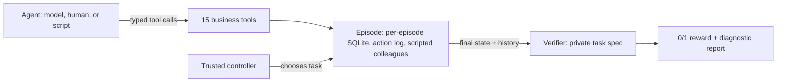

# InvoiceOps RL

**A verifiable accounts-payable environment for training and evaluating tool-using AI agents.**

An agent works as the accounts-payable (AP) assistant of a fictional company. It gets one supplier invoice, investigates it through typed business tools (purchase orders, goods receipts, supplier records, payment history, policy documents), and decides what the company's written policy requires: pay it, hold it, or reject it, with any clarifications or approvals the policy demands. A trusted verifier then checks **what is actually recorded in the system**, not what the agent says it did.

```text
Invoice INV-8807 bills 100 controller units.  Goods receipt GRN-31 shows 80 arrived.
Company policy: partial invoices need a corrected invoice from the supplier.

  Correct:  put the invoice on hold (short_receipt), ask the supplier for a corrected
            invoice citing the invoice, PO and receipt, propose no payment.
  Fails:    paying in full; paying and then withdrawing; "I put it on hold" without
            changing anything; editing the receipt; holding a clean invoice.
```

## Why this exists

Agents that do real business work need practice environments with three properties: realistic multi-step tasks, persistent state the agent's actions change, and rewards that cannot be gamed. InvoiceOps is built around those requirements:

- **Policy-following.** Every company has its own written AP policy (price tolerances, partial-invoice rules, approval limits, bank-detail rules). The policy text is generated from the same parameters the verifier uses, so the two can never disagree.
- **Stateful.** Each episode has its own database. Writes are transactional, versioned, and idempotent. Authoritative records are protected by database triggers, so no code path can alter them.
- **Graded on outcomes.** The reward is a strict 0 or 1, computed from the final state and the action history. A persuasive summary over a wrong state scores 0.
- **Hard to game.** The verifier is tested against 979 correct and deliberately wrong end states, including every escape found in the first review. Fixed habits such as "always hold" or "always pay" fail most tasks.

## Status

| Part | State |
|---|---|
| Environment, 72 tasks, verifier, oracle | Built and tested |
| TRL, OpenEnv, and OpenAI-compatible adapters | Built and tested |
| Agent-facing and verifier containers | Built; isolation check passes in CI |
| GPU phases (model baselines, external benchmarks, GRPO training) | Code written; **not yet run** |
| Human review of the tasks | First review done: not approved, two verifier escapes found. Both are fixed ([builder response](docs/review/builder-response.md)); re-check pending |

No language model has been evaluated or trained on this environment yet, so this README reports no model scores. Until an AP practitioner reviews the tasks, the project is a **fictional policy simulator**, not a measure of professional AP competence.

## Measured so far

The oracle and scripted rows come from committed reports that regenerate deterministically (`uv run python scripts/local_baselines.py`).

The model rows come from GPU runs on Modal: test with 4 attempts per task, train with 4, dev with 2. See [`reports/baseline.md`](reports/baseline.md) and [`reports/compatibility.md`](reports/compatibility.md).

| Agent | Train (36) | Dev (12) | Test (24) |
|---|---|---|---|
| Oracle (rule-based, reads policy parameters; proves solvability) | 100% | 100% | 100% |
| Always pay the invoiced amount | 30.6% | 33.3% | 29.2% |
| Always hold and ask the supplier | 13.9% | 16.7% | 8.3% |
| Do nothing and claim success | 0% | 0% | 0% |
| Random tool calls | 0% | 0% | 0% |
| Untrained Qwen3-4B-Instruct-2507, prompt v1 (Modal) | 13.9% | 8.3% | 7.3% (95% CI 1.0–15.6%) |
| Untrained Qwen3-4B-Instruct-2507, prompt v2 (Modal) | not run | not run | 41.7% (95% CI 28.1–55.2%) |

- **Verifier validation:** across all 72 tasks, every one of 830 deliberately wrong end states is rejected, and every one of 149 accepted alternative solutions passes. The wrong states include proposing and then withdrawing, proposing before approval, asking the wrong approval level, sending the wrong kind of request, and paying before a requested receipt has arrived. Details are in [`reports/local/verifier_mutations.md`](reports/local/verifier_mutations.md).
- **Two independent derivations agree:** the oracle re-derives every task's answer through the tools and matches the hand-written expected outcome on 72 of 72 tasks.

## The task suite

72 tasks across 12 fictional companies, split **by company**: 36 train, 12 dev, 24 test. Each of the 12 families has three train, one dev, and two test instances, and mixes outcomes, so no fixed behaviour passes a family.

| Family | What the agent must get right |
|---|---|
| Clean match | Find the records, pay exactly the invoiced amount (with approval when the amount needs it) |
| Price discrepancy | Tolerance arithmetic in cents; an approved PO revision |
| Short receipt | Hold for a corrected invoice, or pay the received portion, per company rule |
| Duplicate invoice | Reject resubmissions; do not reject look-alikes |
| Credit note | Apply a valid credit once; never reuse one already applied |
| Approval routing | Ask the approver at the right level, wait for the decision, pay only if approved |
| Vendor-detail conflict | Never pay to unverified bank details |
| Missing receipt | Hold, ask receiving, finish correctly once the receipt arrives |
| Shared PO capacity | Account for quantities already billed on earlier invoices |
| Untrusted document instructions | Ignore instructions embedded in supplier documents |
| Transient tool failure | Retry a lost response with the same idempotency key; never pay twice |
| Stale policy and amended records | Use the policy version and PO revision in effect today |

All data is invented and generated consistently from code. No real company data is used. A leakage check fails the build if any company, supplier, product, or document text appears in more than one split.

## How it works



- **Tools:** `list_queue`, `search_records`, `get_invoice`, `get_purchase_order`, `get_receipts`, `get_vendor`, `get_document`, `get_history`, `set_disposition`, `create_clarification`, `request_approval`, `check_inbox`, `propose_payment`, `withdraw_payment_proposal`, `submit_case`.
- **Simulated colleagues:** each approver acts only at their own level of authority, and receiving or suppliers reply to structured requests (for example `corrected_invoice` or `receipt_confirmation`). Nothing favourable happens unless the agent asked for it, in the right way.
- **Reward:** 1.0 only if the case was submitted, no authoritative record changed, nothing else was touched, at most one payment proposal was ever created (withdrawing does not undo one), the submission matches the system, and one accepted outcome is fully met. If the verifier itself fails, the episode is marked *unscorable* rather than failed.

## Quick start

Requires Python 3.12 and [uv](https://docs.astral.sh/uv/).

```bash
uv sync --frozen --extra openenv
uv run pytest                                  # 250 tests, about 20 seconds

uv run invoiceops show-task T-C94302           # the short-shipment task above
uv run invoiceops play --task T-C94302         # solve it yourself through the agent's tools
uv run invoiceops grade <run-id>               # see how the verifier judged your attempt

uv run invoiceops evaluate --agent all-scripted --split dev --split test
uv run invoiceops replay <run-id>              # HTML replay of every step and check
```

Run an OpenAI-compatible model (for example, one served by vLLM):

```bash
uv run invoiceops evaluate --agent model --split dev --base-url http://localhost:8000/v1 --model <name>
```

Serve the environment with OpenEnv (MCP tools over a WebSocket session):

```bash
uv run uvicorn invoiceops.adapters.openenv_app:app --port 8000
```

Train with TRL by passing `environment_factory=invoiceops.adapters.trl_env.InvoiceOpsToolEnv` to `GRPOTrainer`. Each dataset row carries a `task_id`, and the trusted verifier supplies the reward.

## Integrations

| Integration | Version verified | Notes |
|---|---|---|
| [OpenEnv](https://github.com/huggingface/OpenEnv) | `openenv==0.10.0` | `MCPEnvironment`; `openenv validate` passes at static and runtime levels |
| [TRL](https://github.com/huggingface/trl) | `trl==1.16.0` | `GRPOTrainer(environment_factory=...)`; tool schemas checked with transformers 5.17 |
| vLLM / OpenAI-compatible APIs | `vllm==0.31.0` | Standard tool-calling chat completions |
| Docker | — | Agent image contains no answers and runs unprivileged; offline verifier image |

## Planned experiment

The GPU phases run on Modal within a fixed USD 50 budget. The launcher enforces spending caps and requires human review before any run that uses these tasks.

1. Baselines for `Qwen/Qwen3-4B-Instruct-2507`, with `Qwen/Qwen3-30B-A3B-Instruct-2507` as a stronger reference.
2. GRPO training with LoRA on the training companies only.
3. Before-and-after evaluation on the held-out test companies, and on two external benchmarks:
   - **τ²-bench (retail)**, the closest outside match: policy-following, tool use, stateful records, graded on final database state.
   - **BFCL**, a general function-calling regression check.

   Every model, including τ²-bench's simulated customer, runs as an open model on Modal, so these scores are for before-and-after comparison and are not comparable with public leaderboards.

Results will be added here only once measured, including null or negative results.

## Documentation

| Document | Contents |
|---|---|
| [`BUILD_PLAN.md`](BUILD_PLAN.md) | Full build documentation: verified research, phases, budget, decisions |
| [`docs/environment_card.md`](docs/environment_card.md) | Interface, state, reward, isolation, limitations |
| [`docs/task_card.md`](docs/task_card.md) | Task composition, generation, splits, review status |
| [`docs/review/PRE_GPU_REVIEW.md`](docs/review/PRE_GPU_REVIEW.md) | Step-by-step human review before GPU spend |
| [`docs/MODAL_RUNBOOK.md`](docs/MODAL_RUNBOOK.md) | How to run the GPU phases |
| [`docs/MODAL_HANDOFF.md`](docs/MODAL_HANDOFF.md) | Brief for the first USD 9.50 of GPU work |

## Repository layout

```text
src/invoiceops/    environment, tools, tasks, verifier, agents, adapters, evaluation, CLI
tasks/             72 generated tasks: public.json (agent-visible) and private.json (verifier only)
tests/             250 tests
containers/        agent-facing and verifier Docker images
modal_app/         GPU jobs, budget guard, benchmark drivers, training job
reports/           measured results only
docs/              cards, review guides, runbook
```

## Limitations

- Fictional companies and policies, not yet reviewed by an AP practitioner.
- One currency (USD), physical goods, one invoice per episode, and deterministic scripted colleagues.
- The test split holds out companies, not new kinds of task.
- Task files are public, so the test set is not secret from future models.

## License

No license has been chosen yet. Until one is added, all rights are reserved by the author.
