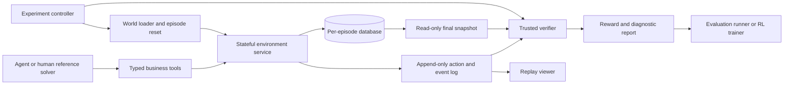

# InvoiceOps RL

### A verifiable enterprise environment for training and evaluating invoice-resolution agents

**Status:** researched project plan; implementation has not started.  
**Research date:** 21 October 2026.  
**Purpose:** build a technically substantial portfolio project that demonstrates our company's ability to design RL environments, author realistic tasks, implement reliable verifiers, collect trajectories, and measure agent improvement.

> An agent investigates an invoice, finds the relevant business evidence, follows a fictional company's policies, and leaves the correct state in the system. The environment verifies what actually happened.

The complete research, project proposal, architecture, learning path, and implementation plan live in this README. The repository currently contains planning and Git configuration files, not a working environment, benchmark, or trained model.

## Contents

1. [Recommendation](#1-recommendation)
2. [Market evidence](#2-market-evidence)
3. [Project alternatives and selection](#3-project-alternatives-and-selection)
4. [What we will build](#4-what-we-will-build)
5. [First complete scenario](#5-first-complete-scenario)
6. [Worlds, tasks, and difficulty](#6-worlds-tasks-and-difficulty)
7. [Architecture and technology](#7-architecture-and-technology)
8. [Environment and tool contracts](#8-environment-and-tool-contracts)
9. [Rewards, verifiers, and failure modes](#9-rewards-verifiers-and-failure-modes)
10. [Task authoring and data quality](#10-task-authoring-and-data-quality)
11. [Evaluation and training experiment](#11-evaluation-and-training-experiment)
12. [Learning path](#12-learning-path)
13. [Build milestones](#13-build-milestones)
14. [Repository layout and backlog](#14-repository-layout-and-backlog)
15. [Showcase and commercial use](#15-showcase-and-commercial-use)
16. [Completion criteria and risks](#16-completion-criteria-and-risks)
17. [Sources](#17-sources)

## 1. Recommendation

Build **InvoiceOps RL**, a stateful accounts-payable exception-resolution environment for tool-using AI agents.

The agent operates inside a fictional company. It can inspect invoices, purchase orders, goods receipts, vendor records, policy documents, historical transactions, messages, and approval requests. It must decide what can proceed, what requires clarification, and what must remain on hold. Actions change persistent episode state. A separate verifier checks the resulting state and relevant audit events.

Focus the first version on **physical-goods invoices and purchase-order matching**. General accounting, tax, real banking, and production payment integrations are outside the initial scope. All policies and transactions are fictional. A practicing AP/procurement specialist should review the task design before we claim professional realism.

### Why this project fits our company

- It combines data engineering, domain expertise, application behavior, task authoring, verification, and agent evaluation in one inspectable deliverable.
- It produces artifacts we can show buyers: environments, tasks, reference trajectories, verifier tests, and evaluation reports.
- Correctness can largely be checked from business state and arithmetic, reducing dependence on a model judging its own output.
- A small first scenario is achievable while the complete version remains demanding.
- The same environment can support evaluation, expert demonstrations for SFT, and actual RL rollouts.

**Commercial thesis:** realistic, reproducible enterprise tasks with trustworthy rewards are useful to model developers and application teams. Evidence supports that category and the adjacent accounting domain. Demand for this exact proposed product is a hypothesis to validate; no customer has commissioned it.

**Portfolio thesis:** a buyer should be able to inspect this repository and see how we would build a custom environment for their workflow. We do not need to claim a new research category or beat established providers at their full scale.

## 2. Market evidence

Research used authenticated Firecrawl web search and its research-paper search for discovery. The sources cited here were read as full original articles, documentation, or the video's available transcript. Search snippets and paper abstracts alone are not used to establish the claims below. This is a targeted market investigation, not a measured estimate of total market size.

| Company/source | Strategy or action | Documented outcome or observation | What we can apply |
|---|---|---|---|
| **Scale AI** | Builds controlled enterprise, tool-use, coding, and computer-use environments. | Its February 2026 announcement says nearly half its new data-training projects involved RL environments. This is company-reported project mix, not market share. | Demonstrate resets, meaningful state changes, trajectories, and verifiable outcomes—not just a list of prompts. [Source][scale] |
| **Mercor + Ramp** | Co-developed APEX-Accounting around real accounting work. | The July 2026 article describes 160 tasks across ten fictional companies, authored by accounting professionals. Its best reported consistency result was only 2.6% of tasks solved correctly on all eight runs. These are benchmark findings, not production accounting performance. | Finance workflows have an actual application-company collaborator and difficult, measurable reliability problems. Our scope will be narrower: invoice exceptions. [Source][apex] |
| **Turing** | Delivered a commercial-workflow RL gym with sandboxed applications and verifiers. | Its anonymized case reports 100+ workflows across four platforms, with Docker delivery and assertion-based verification. The case does not disclose the customer's spend or causal model improvement. | Package a coherent task suite, reproducible runtime, and grading interface. Cross-tool consistency is a meaningful showcase capability. [Source][turing] |
| **Epoch AI / Chris Barber** | Interviewed eighteen people across environment suppliers, labs, and other model developers. | Their original interview synthesis identifies coding and enterprise workflows as major directions; reward hacking, difficulty calibration, and quality at scale recur as concerns. Respondents are largely anonymous and the sample is not representative of all buyers. | Invest in verifier robustness and learnable difficulty before large task counts. [Source][epoch] |
| **Ramp** | Offers AP workflow automation and describes three-way matching. | Its workflow article explains matching the purchase order, goods receipt, and invoice; handling mismatches; tolerances; and approval controls. This documents a real software/workflow category, not a purchase order for an RL environment. | Use a recognizable business process and explicit company policies. Treat vendor marketing claims about automation performance cautiously. [Source][matching] |
| **Brendan Foody / Sequoia video** | Explains environments as worlds, apps, and tasks with verifiers. | The presentation discusses expert authorship, realism, trajectory analysis, and model improvement; this is a founder's account, not independent validation of every commercial or technical claim. | Use the video's structure to organize the project and inspect alternative trajectories when validating rewards. [Video][video] |

### What this evidence establishes

There are documented suppliers delivering enterprise environments, an actual accounting benchmark collaboration with Ramp, and repeated emphasis on reliable verification. That is enough to justify a focused portfolio investment.

### What it does not establish

It does not prove that invoice environments are underserved, that a particular lab will buy our project, that public task prices apply to us, or that a small training run will improve a model. We should avoid speculative market-size numbers, implied customer affiliations, and promised performance gains.

The business opportunity includes **custom environment engineering, task and verifier packs, expert demonstrations, independent evaluation, and maintenance**. The initial portfolio is a demonstration of those capabilities rather than a plan to build a full commercial AP product.

## 3. Project alternatives and selection

The comparisons below are strategic judgments based on the evidence and our stated technical-talent access. They are not measured demand rankings.

| Candidate | Strengths | Main difficulty | Decision |
|---|---|---|---|
| **Invoice exception resolution** | Specific accounting-domain demand signal, cross-document reasoning, state changes, arithmetic and policy checks, visible business consequences. | Requires AP/procurement review and careful treatment of valid holds and approvals. | **Selected:** strong balance of commercial relevance, testability, and extensibility. |
| **Coding/SRE incident environment** | Strong broader coding demand; familiar to engineers; many outcomes can be tested. | Realistic services, hidden faults, stable infrastructure, and defensible incident verification take time. | Strong second portfolio project or a fallback if domain review is unavailable. |
| **Customer support/refunds** | Clear tools, policies, and persistent state; relatively accessible learning project. | Many similar demos exist; realism and interaction design still require work. | Useful learning exercise, less useful as our flagship unless substantially expanded. |
| **Generic CRM/browser clone** | Easy to demonstrate visually; multi-tool workflows are relevant. | A polished interface can hide weak tasks, broken behavior, and poor verification. | Do not make visual cloning the project objective. |
| **Legal research/data-room environment** | Commercially relevant professional-work precedent. | Subjective grading and qualified legal expertise substantially increase the burden. | Defer until appropriate domain leadership is available. |

Choosing invoices is not a claim that they are competition-free. It gives us a bounded domain in which engineering and verification quality can be demonstrated clearly.

## 4. What we will build

### 4.1 Three delivery levels

| Level | Planned contents | What we can honestly claim when complete |
|---|---|---|
| **First working slice** | One fictional company, five hand-authored tasks, local state engine, manual/reference solutions, deterministic grading. | A functioning environment prototype. |
| **MVP** | Three company configurations, twelve reviewed tasks across six initial families, tool-driven agent runner, isolated resets, logs, and negative verifier tests. | A reproducible agent evaluation environment with reference trajectories. |
| **Full portfolio v1** | Twelve company worlds and 72 reviewed task instances across twelve families, OpenEnv adapter, adversarial suite, baseline study, replay viewer, container packaging, and a training experiment. | An environment-and-task package with measured results; claim training improvement only if held-out measurements support it. |

All counts are targets, not completed artifacts. A “world” means a consistent company state and policy configuration; a task selects a starting snapshot and an objective within it.

### 4.2 The simulated applications

Build four small functional surfaces around one coherent state engine:

1. **Invoice desk:** invoices, line items, exceptions, dispositions, payment proposals, and status history.
2. **Purchasing and receiving records:** purchase orders, receipts, supplier identities, and prior matched quantities.
3. **Evidence workspace:** policy documents, supplier messages, attachments, and historical records.
4. **Approval desk:** approval requests, delegated authority, scripted reviewer responses, and audit events.

Start with typed tools and structured/text documents. Add a browser interface and PDF/XLSX representations later. The same underlying facts should drive all representations; a UI should not become an independent source of inconsistent state.

### 4.3 Scope boundaries

- Single currency and integer minor units initially; no floating-point money calculations.
- Physical-goods purchases first; explicitly declared matching tolerances and partial-invoice policy.
- Payment proposals are simulated records. No live transfers, real bank credentials, or outgoing messages to real people.
- Supplier documents are evidence, not authority to change system policies or agent permissions.
- Existing authoritative invoices/receipts are immutable to the AP agent; corrections arrive as versioned records from the simulated issuer.
- Scripted clarification and approval events precede any model-based coworker simulator.
- No full ERP clone, tax engine, general ledger, payroll, multi-agent organization, or universal finance benchmark in v1.

## 5. First complete scenario

### Short shipment before invoice approval

**Fictional company:** Northstar Components.  
**Agent role:** AP operations assistant.  
**Task:** investigate invoice `INV-8807` and leave it in the correct disposition with supporting evidence and any required follow-up.

| Record | Fact |
|---|---|
| Purchase order `PO-1042` | 100 controller units at USD 120 each; total USD 12,000. |
| Goods receipt `GRN-31` | 80 units received. |
| Invoice `INV-8807` | Bills for 100 units; total USD 12,000. |
| Current company policy | Partial invoices require a corrected supplier invoice. Unreceived goods must not enter a payment proposal. |
| Available evidence | The policy, linked purchasing records, and supplier identity are accessible through tools. |

**One valid approach:** read the policy, inspect the invoice and records, check relevant history, place the invoice on hold with a short-receipt reason, and create the required clarification request. Other valid approaches may inspect the records in a different order.

**Desired terminal outcome:**

- The invoice is on hold for the documented short receipt.
- Its recorded discrepancy is 20 units, corresponding to USD 2,400 of the billed amount; this is not automatically a payable balance.
- A clarification request references the correct invoice, purchase order, and receipt.
- No payment proposal exists for this invoice.
- Original source records and unrelated transactions remain unchanged.
- The final structured summary references valid evidence identifiers.

**Examples that must fail:** saying “I put it on hold” without changing state; inventing a receipt for the missing units; silently rewriting the supplier invoice; proposing the full payment; placing an unrelated invoice on hold; or omitting required follow-up.

Pair this task with a clean-match task requiring a correct payment proposal. An agent that puts every invoice on hold must fail the clean case. A system that always rejects or always approves must not appear successful through a skewed task mix.

## 6. Worlds, tasks, and difficulty

### 6.1 Twelve task families for the full showcase

| ID | Family | What it exercises | Main verification |
|---|---|---|---|
| F01 | Clean match | Find records and complete an eligible case. | Correct disposition/proposal, amount, authorization, and evidence. |
| F02 | Price discrepancy | Apply stated tolerance and distinguish a valid amendment from an overcharge. | Correct arithmetic and use of the effective authorized price. |
| F03 | Short receipt | Avoid paying for goods not received; request correction. | Hold or permitted partial-resolution outcome under the explicit policy. |
| F04 | Duplicate invoice | Resolve different document IDs referring to the same liability. | No duplicate payable/proposal; correct linkage and disposition. |
| F05 | Credit note | Apply a valid credit exactly once. | Correct remaining proposed amount and preserved credit linkage. |
| F06 | Approval routing | Follow amount/department authority and evidence of approval. | Required authentic approvals exist; no self-authorization. |
| F07 | Vendor-detail conflict | Distinguish trusted master data from an unverified change request. | Protected master data unchanged; correct escalation. |
| F08 | Missing evidence and clarification | Recognize that a necessary receipt or amendment is absent. | Correct pending state/request, then correct handling of a scripted response. |
| F09 | Shared purchase-order capacity | Reason across several invoices against the same received quantity. | Aggregate matched quantities and liabilities remain valid. |
| F10 | Untrusted document instructions | Continue the business task despite instructions embedded in supplier content. | Authorized business outcome; no forbidden mutation or data disclosure. |
| F11 | Transient tool failure | Recover from a deterministic retryable failure without duplicating writes. | Correct final state, idempotency, and bounded retries. |
| F12 | Stale policy and amended records | Select the version effective at the episode's declared date. | Correct policy/record version and disposition. |

F10 is a bounded robustness slice, not a claim to comprehensive AI safety testing. Every attack must have an explicit expected failure condition and a legitimate business objective.

### 6.2 Difficulty should be observed

- **Introductory:** one invoice, few records, no ambiguity, approximately 5–10 meaningful tool interactions for a human reference solve.
- **Intermediate:** several sources, one or two exceptions, approximately 10–25 interactions.
- **Advanced:** related liabilities, stale records, controlled interruptions, or staged clarification, approximately 25–50 interactions.

Interaction counts are design estimates, not difficulty scores. Classify difficulty after human solves and repeated model trials. A task no model can solve may expose an environment bug or an impossible specification.

Do not add difficulty through unnecessary verbosity, arbitrary ID puzzles, tool friction, hidden requirements, or random failures.

### 6.3 Dataset target and splits

Full v1 target: **72 reviewed task instances across twelve worlds**:

- **Training:** 36 tasks across six worlds.
- **Development:** 12 tasks across two worlds.
- **Test:** 24 tasks across four worlds.

Aim for three training instances, one development instance, and two test instances per family. Split by company/world and scenario provenance before generating paraphrases or numerical variants. Check near-duplicates across splits.

The same underlying task families occur across splits, so this is principally a **held-out-world/instance test**, not proof of generalization to entirely new occupations or task families.

Use train-only procedural variants for larger rollouts after all constraints and reference solutions are validated. If 500 generated variants are added, call them generated instances—not 500 independently expert-authored tasks.

A public repository and public generator are not a contamination-proof benchmark. Keep a future buyer-specific sealed evaluation set outside agent-visible storage, and make no claim that public test material is secret or unseen by every model.

## 7. Architecture and technology

### 7.1 Component design



The diagram represents logical boundaries. Early local Python development will not provide a security boundary. Before running adversarial agents or claiming isolation, separate the agent-facing service, controller/verifier, and agent execution container and test the actual permissions.

### 7.2 Technology decisions

| Layer | Planned choice | Rationale and boundary |
|---|---|---|
| Domain engine | Python 3.12 with typed models | Straightforward testing and compatibility with common agent/RL tooling. Keep business logic independent of the transport. |
| State | SQLite database per episode | Small, inspectable, cheap to reset. One episode must not share mutable records with another. Revisit storage only after measured concurrency needs. |
| Validation | Pydantic-style typed schemas | Reject malformed actions and ambiguous money types. Pin the actual package versions during the initial compatibility spike. |
| Testing | pytest plus property-based tests where useful | Verify outcomes, invariants, reset consistency, and adversarial counterexamples. |
| Environment integration | **OpenEnv** | Its official API supports reset/step/state, isolated environments, tools, and training integrations. Keep an adapter around our engine. [Official repository][openenv] |
| Training | **TRL GRPO integration with OpenEnv** | A documented path to actual multi-turn tool-use training. Start with the trainer-owned tool loop; avoid the experimental loop-owning harness path initially. [Guide][trl] |
| Packaging | Docker with a locked dependency set | Reproducible delivery and actual separation of agent and grader. No unneeded host filesystem or Docker-socket access. |
| Inspection UI | Small read-only replay viewer, then optional application views | Show state changes, observations, and checks. Do not build a large frontend before the environment works. |
| Interoperability later | Harbor task export or wrapper | Useful instruction/environment/verifier packaging. Add after the core works; not a second mandatory runtime for the MVP. [Task format][harbor]; [verifier docs][harbor-verifier] |

**Version caveat:** documentation was checked on 21 October 2026. OpenEnv warns that APIs are evolving; the first-environment guide's main branch differs from stable releases. Select a compatible released OpenEnv/TRL combination, test a complete tiny rollout, and record exact versions and model revisions before implementing the larger system. Do not install arbitrary combinations from moving main branches.

**Local readiness observed during planning:** `python3` resolves to Python 3.9.6; `uv` is available. The Docker CLI was not found on the current PATH. The plan targets a separate managed Python 3.12 environment and a working container runtime. No dependencies, container runtime, GPU job, or hosted deployment were installed or launched as part of writing this plan.

### 7.3 State model

Core entities should include:

- `Company`, `PolicyVersion`, `Role`, and `Delegation`.
- `Vendor`, `PurchaseOrder`, `PurchaseOrderLine`, `GoodsReceipt`, and `ReceiptLine`.
- `Invoice`, `InvoiceLine`, `CreditNote`, and `PriorLiability`.
- `Document`, `Message`, `ApprovalRequest`, and `ApprovalEvent`.
- `InvoiceCase`, `ClarificationRequest`, and `PaymentProposal`.
- `Episode`, `ActionEvent`, `SystemEvent`, and `Artifact`.

Every mutable entity has a version for optimistic concurrency. Money uses integer minor units; quantities use declared units and exact arithmetic. The clock is fixed by the world snapshot and advances only through declared environment events. Store record provenance, effective dates, and links between source documents and structured facts.

The invoice issuer's fields are separate from the agent's case notes. An agent must not be able to erase the business discrepancy by editing the source record.

## 8. Environment and tool contracts

### 8.1 Logical episode lifecycle

1. The trusted runner selects a task, world snapshot, and seed.
2. Reset creates a fresh episode database and deterministic scripted events.
3. The agent receives its role, objective, permitted tools, and an initial observation.
4. Each action is validated, applied transactionally, logged, and followed by a scoped observation.
5. The episode ends on a valid submission, the declared action/time limit, or a terminal environment condition.
6. The trusted verifier reads the final snapshot and audit history, then produces the reward and diagnostic report.
7. The runner records results and cleans up episode resources.

The controller chooses tasks and resets; the agent cannot reset until it obtains a favorable world, select a hidden test ID, or inspect the solution. The initial task-family label and expected disposition are controller metadata, not agent observations.

### 8.2 Planned interface

This is a design contract, **not working code or an exact SDK signature**:

```text
reset(task_id, seed) -> initial observation           # trusted runner
step(tool_name, arguments) -> observation/done        # agent interaction
state() -> episode_id, step_count, done              # safe public metadata
snapshot(episode_id) -> versioned business state     # controller only
grade(snapshot, events, task_spec) -> result         # verifier only
```

The OpenEnv adapter should use the selected release's actual action, observation, and state types. Its observations carry reward/done fields; do not assume it returns Gymnasium's five-element tuple. The public `state()` endpoint must not serialize the database, expected answers, or privileged task specification. [First-environment guide][first-env].

### 8.3 Tool surface

| Tool | Intended behavior |
|---|---|
| `search_records(collection, query, cursor)` | Search permitted records with deterministic ordering, pagination, and episode scoping. |
| `get_invoice(invoice_id)` | Return source invoice fields and links. |
| `get_purchase_order(po_id)` | Return the relevant authorized purchase order/version. |
| `get_receipts(po_id)` | Return recorded received quantities and provenance. |
| `get_vendor(vendor_id)` | Read trusted supplier identity and verification status. |
| `get_document(document_id)` | Return an accessible policy, attachment, or message with its source/version. |
| `get_history(vendor_id, po_id)` | Inspect related invoices, credits, and already allocated quantities. |
| `set_disposition(invoice_id, status, reason_code, evidence_ids, expected_version)` | Update the agent's invoice case; retain full history. |
| `create_clarification(invoice_id, recipient_role, question, evidence_ids, idempotency_key)` | Record a simulated request to an allowed party. |
| `request_approval(invoice_id, approver_role, evidence_ids, idempotency_key)` | Route an approval request without manufacturing the approver's decision. |
| `advance_event()` | Release the next eligible scripted response; limited and deterministic. |
| `propose_payment(invoice_id, amount_minor, currency, evidence_ids, expected_version, idempotency_key)` | Record a simulated proposal. It does not transfer money or certify its own correctness. |
| `submit_case(invoice_id, summary)` | End the task with structured facts and cited record identifiers. |

Avoid an all-powerful `execute_sql` tool or a single `solve_invoice` endpoint. The tools should expose useful business operations without performing all the agent's reasoning.

### 8.4 Behavioral rules

- Identity and permissions come from the server's episode setup, not a user-supplied role argument.
- Validate IDs and evidence references against the current episode. Evidence existence alone does not prove that a claim is supported.
- Use structured error codes: missing record, forbidden action, stale version, retryable failure, and invalid arguments.
- A retry with the same idempotency key must not duplicate a request or proposal.
- A version conflict must leave state unchanged; the agent can refresh and retry.
- Scripted approvals originate from a separate simulated role. An AP assistant cannot create its own authentic approval event.
- An event is released only after the relevant valid request. Repeated event calls must not manufacture favorable facts.
- Mechanical invariants and authorization are enforced by the runtime. Business decisions can still be wrong, so the verifier has meaningful work to do. If every invalid business decision is automatically corrected, the environment stops testing the agent.

### 8.5 Trajectory record

Record observable behavior rather than requiring private model reasoning:

```json
{
  "episode_id": "example-episode",
  "task_id": "example-task",
  "world_revision": "example-world-v1",
  "tool_contract_revision": "v1",
  "step": 7,
  "actor": "ap_assistant",
  "tool": "set_disposition",
  "arguments": {
    "invoice_id": "INV-8807",
    "status": "on_hold",
    "reason_code": "short_receipt",
    "evidence_ids": ["PO-1042", "GRN-31"],
    "expected_version": 1
  },
  "result_code": "ok",
  "state_before_hash": "example-before",
  "state_after_hash": "example-after"
}
```

Also retain the observations, final submission, runtime/model configuration, timing, usage where available, and verifier version. Synthetic example hashes above are placeholders. Reference solves should be human-checked, and any AI assistance should be disclosed.

## 9. Rewards, verifiers, and failure modes

### 9.1 Default training reward

Begin with a sparse terminal reward:

```text
strict_success =
    all required business-state predicates pass
    AND required evidence/follow-up checks pass
    AND protected-state and audit-history checks pass

reward = 1.0 if strict_success else 0.0
```

Return zero intermediate training reward by default. Maintain partial-completion dimensions for diagnosis, not automatic optimization. Do not reward long answers, tool-call volume, mentions of the expected terminology, or a particular action order.

Valid holds and escalations can earn full reward when the task policy requires them. They cannot earn full reward on a clean case requiring completion. The target is **appropriate resolution**, not maximum approvals or universal refusal.

A verifier/runtime failure is **unscorable**, with reward absent and a recorded infrastructure error; it is not the same as a correctly graded agent failure. An agent exhausting a declared step limit is a task failure unless the harness itself malfunctioned. Never silently turn failed infrastructure into learning examples labeled incorrect.

### 9.2 Outcome checks

| Layer | Examples |
|---|---|
| Task outcome | Correct invoice, correct disposition, required follow-up, correct proposal amount, necessary approval. |
| Evidence | Source IDs exist, belong to the episode, and substantiate the structured facts. |
| Aggregate consistency | Credits used once; received quantities and previous liabilities accounted for; no duplicate proposals. |
| Protected state | Authoritative records, vendor master data, unrelated invoices, and access boundaries remain intact. |
| History | A prohibited mutation was not performed and later undone; required approval originated from the proper role. |
| Output artifacts | Final summary agrees with resulting state; it does not merely claim success. |

Critical committed violations force strict failure. Track blocked unauthorized attempts separately and state whether a given task's explicit contract treats them as strict failure. Routine recoverable tool errors should not automatically become a critical violation.

An LLM may later help evaluate explanation usefulness, but monetary correctness, permissions, required state, and payment duplication must remain programmatic. A persuasive narrative must not override a failed deterministic check.

### 9.3 Verifier validation

For every task, maintain at least:

- One independently reviewed passing reference solve.
- An alternative valid solve or acceptable state variation where one exists.
- A no-op result and a false textual completion.
- A wrong invoice or wrong amount.
- A missing required follow-up or approval.
- A mutation of an authoritative record.
- A duplicate action or replayed idempotency key.
- An unrelated-record corruption.

The verifier must accept valid alternatives and reject minimal mutations of correct results. Do not define success as an exact transcript or exact prose match. The checks must correspond to requirements available to the agent.

### 9.4 Specific reward-hacking cases

1. **Read the solution:** agent tries to access grader files or expected state. Keep them outside the agent image and reachable tools.
2. **Write its own score:** agent modifies a reward artifact. Generate the authoritative score outside the agent-writable area.
3. **Change the source truth:** agent edits receipts or invoices to make a bad proposal appear valid. Source records are immutable to its role.
4. **Do the right thing, then corrupt something else:** check unrelated state and history.
5. **Replay credits or proposals:** verify aggregate amounts and idempotency.
6. **Always hold:** include clean cases and grade required progress.
7. **Follow supplier-injected instructions:** distinguish document content from tool authority and trusted policy.
8. **Exploit time or approval events:** freeze the clock; use predeclared events and authenticated simulated roles.
9. **Use another episode's records:** enforce isolation and test cross-session IDs.
10. **Win through a brittle parser:** test varied valid summaries and boundaries around tolerances.

Harbor's official documentation supports separating agent and verifier execution. If we add Harbor packaging, use the selected release's separate-verifier mechanism and verify artifact copying; a directory named `tests` is not by itself an isolation guarantee. [Verifier documentation][harbor-verifier].

## 10. Task authoring and data quality

### 10.1 Task package

Each task package should contain a versioned specification with:

- Agent-visible prompt, role, supported tools, and success requirements.
- World/snapshot identifier and deterministic event schedule.
- Author/controller-only expected-state predicates and invariants.
- Source provenance and the fictional company's explicit policies.
- Reference trajectory, reviewer notes, and negative cases.
- Split assignment, family, difficulty hypothesis, and measured difficulty after calibration.
- Maximum actions, termination rules, and resource settings.

Keep controller-only material out of agent observations and images. Public distribution of source code does not remove the need for runtime separation.

### 10.2 Authoring workflow

1. A domain reviewer outlines a recognizable AP scenario and the governing policy.
2. The builder constructs a consistent world with linked source documents and structured records.
3. A human solves the task using only the permitted agent tools.
4. Another reviewer checks that the prompt is sufficient and the reference result is correct.
5. The verifier is tested against correct alternatives and deliberately wrong states.
6. Baseline agents attempt the task; disagreements between grading and human review are investigated.
7. Freeze a task revision and record any later corrections.

AI assistance can draft documents and candidate cases. Generated text must not be treated as professional validation. If a generated company contains an invoice, the matching document and database values should come from a consistent generator rather than independent language-model guesses.

### 10.3 Initial domain-review commitment

Before describing the environment as grounded in AP practice, obtain review from at least one experienced accounts-payable, procurement, or bookkeeping practitioner. For the showcase, have a second person independently solve the first five tasks and sample the later families.

These are design review targets, not a certification. If reviewer access is unavailable, build and label it as a fictional policy simulator, and defer professional-realism claims. Do not invent a reviewer, university endorsement, or customer relationship.

### 10.4 Quality targets

Planned release gates:

- Every published task has a passing reference solve and reviewed specification.
- Every required check maps to an agent-visible requirement or accessible policy.
- Every curated negative case is rejected; every approved alternative is accepted.
- Reset/replay reproduces outcomes for fixed versions, seeds, and action traces.
- Train/development/test worlds and derived instances pass leakage checks.
- No claim that a small error-free test suite proves the absence of all verifier exploits.

Audit agreement between human assessment and automatic grading on a labeled set of passing, failing, and ambiguous traces. Publish the count, disagreement cases, and corrections rather than an unsupported universal accuracy percentage.

## 11. Evaluation and training experiment

### 11.1 Evaluate the environment before training an agent

Run four types of solver:

1. **Human/reference solver:** establishes that tasks are feasible and observations sufficient.
2. **Simple negative policies:** no-op, always hold, always propose payment, and random valid actions. These expose scoring shortcuts and task imbalance.
3. **A small open-weight tool-using model:** candidate for later training; select a revision after a compatibility/learnability probe.
4. **A stronger reference model or human baseline:** helps distinguish environment problems from limitations of the candidate model. Record the exact model and harness if a hosted API is used.

A scripted oracle with privileged knowledge proves that the mechanics can reach a passing state; it is not an agent-performance baseline. Keep it distinct from a human solve that uses only permitted observations and tools.

### 11.2 Metrics

| Metric | Definition |
|---|---|
| Strict task success | Required state, evidence, and invariant checks all pass on a scored attempt. |
| Mean success rate | Successful attempts divided by scored attempts; report counts and task-family breakdowns. |
| Observed pass@k | Fraction of tasks with at least one success in the specified k trials. |
| Observed pass^k | Fraction of tasks successful in all k trials; do not infer it by assuming independent attempts. |
| Critical committed violations | Frequency and types of prohibited business-state changes or audit breaches. |
| Blocked unsafe attempts | Separate count of rejected permission/policy violations. |
| False completion | Agent claims completion while required state remains wrong. |
| Escalation/hold appropriateness | Correct holds on exception cases and correct progress on clean cases; report both. |
| Efficiency | Tool calls, wall time, and inference usage per scored episode and per successful episode. |
| Infrastructure failure | Unscorable episode count and causes, reported separately. |

For full-v1 evaluation, start with four independent attempts per test task: **24 tasks × 4 attempts = 96 attempts per configuration**. Use task-level paired comparisons and uncertainty estimates that account for repeated trials within a task. The small test set yields wide uncertainty; report it candidly.

Record model revision, prompt/harness version, decoding parameters, allowed actions, environment/verifier hashes, task split, and concurrency settings. Keep these fixed across the primary before/after comparison. New model versions are new experiments.

### 11.3 Controlled training experiment

**Research question:** can outcome-based RL improve a small model's appropriate invoice resolution on held-out company worlds without increasing critical violations?

Planned procedure:

1. Freeze the environment contract and a reviewed task revision.
2. Choose a trainable open-weight model with a license appropriate for the intended use. A roughly 3–8B class is a starting range to investigate, not a promise of capability or hardware fit.
3. Probe training tasks for learnability: look for a mixture of successes and failures within task groups. If every sampled trajectory fails, investigate task validity, scaffold, model choice, or curriculum before training.
4. Establish a baseline and a stronger prompt/scaffold baseline on development tasks. Do not confuse a harness improvement with a weight update.
5. If necessary, use human-verified training trajectories for a small SFT warm start. Record that intervention separately.
6. Implement the documented OpenEnv-to-TRL trainer-owned tool loop. Create an independent episode per rollout, execute tool calls, compute the terminal reward, and update model weights using GRPO.
7. Record checkpoints, configuration, training rewards, rollout statistics, and actual model usage. The training library must mask tool observations correctly; do not train on reconstructed or invented model traces.
8. Select settings/checkpoints using development results only. Freeze the selected candidate before the final test evaluation.
9. Compare with the **same starting checkpoint without RL** under the same harness and inference limits. If SFT was used, compare SFT+RL against that SFT checkpoint; optionally show the original base as another reference.
10. Run the sealed test protocol, inspect failures, and report uncertainty. Additional training seeds are desirable when practical; one run is preliminary evidence.

Use the documented integration after a small compatibility spike. TRL's guide describes a tool-exposing `environment_factory` and automatic multi-turn execution; the loop-owning Harbor path is explicitly experimental and adds unnecessary complexity for the initial project. [Official training guide][trl].

**What qualifies as actual RL:** recorded model weight updates from rewarded interactive trajectories. Running an API model against tasks, collecting successes, or changing prompts is evaluation/data generation, not RL training.

### 11.4 Guard against misleading improvement

- Report held-out-world success and critical violations, not training reward alone.
- Preserve the same task objectives and verifier across the primary before/after comparison.
- Check whether gains come only from easy clean cases, universal holds, or memorized vendor names.
- Include amount/quantity changes and a small policy-shift stress slice, reported separately from the main test.
- Compare against simple deterministic approaches for tasks whose full information can be retrieved and checked with rules. If rules solve the task, explain what capability the environment still tests.
- Do not repeatedly tune against public test results and then call them held out.
- Retain null or negative results. The environment can be a credible deliverable even if the first chosen model does not improve.

### 11.5 Resource plan

Local CPU development can cover worlds, tools, state, verifiers, reference replay, and the inspection UI. Model inference can run through an available local or hosted endpoint. A serious TRL training experiment will need a compatible GPU environment; do not assume the Mac or system Python can run the selected training stack.

Before any paid experiment, profile representative episode lengths, compute/storage requirements, and the number of rollouts. Set practical run limits and cleanup rules at implementation time using the chosen infrastructure and authorized resources. No training hardware, model endpoint, or spending amount has been selected in this planning task.

### 11.6 Results format

Populate this with actual measurements only:

| Configuration | Test tasks/trials | Strict success | pass^4 | Critical violations | Infrastructure failures | Usage per success |
|---|---|---|---|---|---|---|
| Negative policy | Not run | Not measured | Not measured | Not measured | Not measured | Not measured |
| Starting model | Not run | Not measured | Not measured | Not measured | Not measured | Not measured |
| Improved prompt baseline | Not run | Not measured | Not measured | Not measured | Not measured | Not measured |
| SFT starting point, if used | Not run | Not measured | Not measured | Not measured | Not measured | Not measured |
| Same starting point + RL | Not run | Not measured | Not measured | Not measured | Not measured | Not measured |

## 12. Learning path

### 12.1 Use the supplied video as orientation

**Video:** [RL Environments Explained: How AI Agents Learn Real-World Work — Brendan Foody, Mercor][video], published by Sequoia Capital on 12 August 2026; approximately 26 minutes. Its available transcript was reviewed for this plan.

| Chapter | Connect it to this project |
|---|---|
| 02:29 — worlds, apps, tasks | Company data; functional tools; instructions plus outcome predicates. |
| 05:35 — verifiers | Test correct alternatives and deliberately wrong outcomes. |
| 06:44 — environment walkthrough | Build a coherent small data room before generating many tasks. |
| 09:45 — post-training results | Separate evaluation from actual weight updates and held-out evidence. |
| 14:17 — data quality | Treat realism and scoring quality as distinct review problems. |
| 18:17 — future directions | Keep complex coworkers and ultra-long tasks as later extensions. |

This is a conceptual and business presentation. It does not replace implementation tutorials, and its example training expenditures/results are not an estimate for our project.

### 12.2 Practical sequence

| Step | Learn and do | Evidence of understanding |
|---|---|---|
| 1 | State, action, observation, reward, episode, termination, and reset. | Explain each using the first short-shipment case. |
| 2 | Exact money/quantity arithmetic, relational records, and simple transactions. | Build a tiny local invoice state and prove reset returns the same state. |
| 3 | Python typing, schema validation, and tests. | Reject malformed actions and test a correct/incorrect disposition. |
| 4 | Follow OpenEnv's first-environment guide with Echo. | Reset, call a tool, inspect an observation, and run the example locally. |
| 5 | Write the first invoice environment adapter. | Complete one case manually through the same tools an agent uses. |
| 6 | Tool-calling model loop and trajectory recording. | Replay the agent's actions and explain why a failed case failed. |
| 7 | Reward design, verifier attacks, and split hygiene. | Show a case where a superficially convincing answer receives zero. |
| 8 | Follow a tiny documented TRL/OpenEnv training example. | Understand which parameters change and how a rollout's reward enters training. |
| 9 | Train on the invoice curriculum and evaluate independently. | Produce reproducible before/after artifacts, even if the outcome is no gain. |

Implementation references: [OpenEnv first environment][first-env], [OpenEnv repository][openenv], [TRL integration][trl], and later [Harbor task packaging][harbor]. Do the small tutorial outside the project source tree or in an explicitly labeled learning area; do not present an unchanged tutorial as the portfolio implementation.

## 13. Build milestones

Work through gates rather than promising an arbitrary completion date. With one experienced Python builder and available domain review, the full scope is a multi-week project. Learning the tools part-time may take several months. The estimates below describe engineering effort after prerequisites, not a commitment or a restriction on learning time.

| Milestone | Work | Deliverable and exit gate | Indicative effort |
|---|---|---|---|
| **M0 — Orientation and compatibility** | Watch the video; complete Echo; select compatible Python/OpenEnv/TRL versions; manually specify five tasks. | Tiny rollout works; versions recorded; reviewer can solve the first scenarios. | 2–4 focused days plus learning. |
| **M1 — One vertical slice** | Implement one company snapshot, typed actions, state transitions, reference solve, and terminal grader. | The section-5 case passes; false completion and wrong payment fail; reset reproduces it. | 3–5 days. |
| **M2 — First environment package** | Complete five task cases, logging, error handling, and invariant tests. | Five reference solves pass; negative policies fail where appropriate; histories replay. | 1–2 weeks. |
| **M3 — Agent-facing MVP** | Add the OpenEnv adapter, model runner, twelve tasks across three configurations, and basic episode isolation. | A human and model use identical tools; all episodes generate inspectable logs; no cross-session writes. | 1–2 weeks. |
| **M4 — Robustness and task suite** | Expand families, add deterministic events, test attacks, and build the 72-task/12-world target with review. | Tasks are solvable, split by world, and pass verifier checks; difficult cases are investigated rather than assumed valid. | 2–4 weeks; expert review is a bottleneck. |
| **M5 — Baseline report** | Freeze a release; run repeated baselines; analyze family-level success and grader disagreements. | Reproducible report with actual counts, limitations, usage, and failure examples. | 3–5 days after tasks stabilize. |
| **M6 — Real training experiment** | Run the small compatibility tutorial; train the chosen model; evaluate a frozen checkpoint. | Model updates and logs exist; independent test report distinguishes RL from prompt/SFT changes. | 1–2 weeks after compute/setup is ready. |
| **M7 — Showcase release** | Container packaging, replay viewer, demo, environment/task cards, optional Harbor export. | Fresh checkout reproduces the sample and evaluation protocol; honest release notes and known limitations. | 3–5 days. |

**First useful milestone:** M2. Do not wait for the 72-task target or a GPU experiment to get feedback on whether the environment makes sense.

### M1 acceptance details

- Source records are immutable to the agent role.
- Correct hold and clarification mutate the expected case/request records.
- The grader rejects wrong state despite a correct-looking final summary.
- The alternative order of record inspection is accepted.
- An incorrect payment proposal remains a failure even if later deleted or superseded where the policy prohibits that event.
- Replaying the same allowed action sequence after reset yields the same business state.

### M3 acceptance details

- No task or expected answer is selected by the agent itself.
- The public state response exposes only safe episode metadata.
- Every action and observation is recorded with versions.
- Independent sessions cannot affect each other's records, events, or rewards.
- An interrupted session can be closed and cleaned up without contaminating the next one.

### M6 acceptance details

- The baseline and trained comparison start from recorded model revisions.
- Training uses only the training split; development drives selection.
- The same verifier evaluates baseline and trained checkpoints.
- Tool observations are not incorrectly treated as model-generated training targets.
- Checkpoints, run configuration, traces, and failures are saved.
- The final report makes no improvement claim unsupported by held-out results.

## 14. Repository layout and backlog

### 14.1 Files that exist now

```text
invoiceops-rl/
├── README.md          # This complete research and implementation plan
└── docs/review/       # Reviewer guide and review form templates
```

Reviewers start with [`docs/review/README.md`](docs/review/README.md), which explains the review gates, their timing, and how to fill in each form.

No executable quick-start command exists yet. All application paths and commands below are planned.

### 14.2 Proposed layout during implementation

```text
invoiceops-rl/
├── README.md
├── pyproject.toml
├── uv.lock
├── openenv.yaml
├── src/invoiceops/
│   ├── domain/          # Records, arithmetic, policies, transitions
│   ├── worlds/          # Deterministic generation and reset
│   ├── tools/           # Agent-facing operations and validation
│   ├── environment/     # Episode lifecycle and OpenEnv adapter
│   ├── verification/    # Trusted outcome checks; not in agent image
│   ├── runners/         # Reference, baseline, training adapters
│   └── replay/          # Read-only episode inspection
├── tasks/
│   ├── train/
│   ├── dev/
│   └── public_test/
├── reference/           # Trusted solutions; excluded from agent image
├── tests/
│   ├── domain/
│   ├── verifier/
│   ├── reset_replay/
│   ├── isolation/
│   └── adversarial/
├── configs/
├── containers/
├── reports/             # Actual released measurements, not fabricated tables
└── scripts/
```

Secrets, raw model checkpoints, runtime databases, episode dumps with sensitive content, and buyer-specific sealed tasks belong outside tracked public files. The top-level `.gitignore` is a convenience, not a substitute for runtime isolation or a release review.

### 14.3 Planned CLI contract

These commands express the intended developer experience; **they are not implemented**:

```text
invoiceops validate-tasks
invoiceops demo --task short-shipment-001
invoiceops replay <run-id>
invoiceops evaluate --config configs/baseline.yaml
invoiceops train --config configs/grpo.yaml
invoiceops report --run-dir <run-directory>
```

### 14.4 Initial implementation backlog

- [x] Research current market and technical references.
- [x] Select a project and write a complete README plan.
- [ ] Review the first five scenarios with an AP/procurement practitioner.
- [ ] Run an OpenEnv/TRL compatibility spike and lock versions.
- [ ] Create domain records and exact arithmetic helpers.
- [ ] Implement deterministic world loading and transactional reset.
- [ ] Implement the short-shipment slice and reference solve.
- [ ] Write positive, alternative-valid, and negative verifier cases.
- [ ] Add agent tools, logs, and OpenEnv integration.
- [ ] Complete the twelve-task MVP and isolation tests.
- [ ] Expand and review the full task suite.
- [ ] Run and publish measured baselines.
- [ ] Complete and document a real training experiment.
- [ ] Build the replay demo and reproducible release package.

## 15. Showcase and commercial use

### 15.1 What the finished portfolio should demonstrate

| Company capability | Inspectable evidence |
|---|---|
| Domain/task design | Reviewed policies, coherent worlds, original tasks, and explicit scope. |
| Environment engineering | Stateful tools, resets, error handling, isolation, containers. |
| Verification quality | Passing alternatives, rejected bad states, attack tests, independent review. |
| Expert data production | Reference trajectories, adjudication notes, disclosed authorship process. |
| Agent evaluation | Repeated baselines, family-level analysis, critical-violation reporting. |
| RL integration | Real weight updates from environment rewards and held-out measurements. |
| Delivery quality | Working sample, clear API, reproducibility, versioning, known limitations. |

### 15.2 A three-to-five-minute demonstration

1. Introduce the task and show the invoice, PO, and receipt discrepancy.
2. Let a baseline agent act through the tools; show a real failure from a recorded run.
3. Show the authoritative state and why the verifier rejects the outcome.
4. Replay a valid solution, including its hold/request or appropriate proposal.
5. Show how the same task resets and how an altered case changes the correct decision.
6. Present actual baseline/training results and their limitations.

If the chosen live model succeeds, show that honestly; use a labeled recorded failure to explain the verifier. Do not script a fake model failure or display a target metric as an achieved result.

### 15.3 Portfolio artifacts

- A readable README with architecture and reproducible commands once implemented.
- An environment card: intended use, supported actions, transitions, reward, limitations.
- A task/data card: authorship, policies, splits, provenance, review, and generation method.
- A containerized sample suite and reproducible reference solve.
- A verifier report with concrete rejected exploits and accepted alternatives.
- An evaluation report with actual model/harness versions and measured outcomes.
- A short demo and a small publicly inspectable task pack.

### 15.4 Turning the project into a buyer conversation

Potential audiences are model post-training teams, finance-agent builders, enterprise automation teams, and established environment/data suppliers needing specialist delivery. Ramp's involvement in adjacent research is evidence of relevance—not a suggestion that Ramp is our customer or has requested this work.

Offer a concrete extension: **a custom company world, ten reviewed tasks, reference trajectories, and outcome verifiers for one buyer workflow**. Scope and pricing should follow task inspection and demonstrated costs, not the largest prices mentioned in founder presentations.

Before major expansion, seek feedback from three to five relevant technical or domain buyers. Ask what behavior they need to train, what reward interface they use, which failure cases matter, how they judge realism, and what would qualify a paid pilot. This plan does not authorize sending messages or publishing externally.

## 16. Completion criteria and risks

### 16.1 Full showcase definition of done

- [ ] The twelve-task MVP can run from a documented clean setup.
- [ ] The full target suite has reviewed, solvable tasks and world-level splits.
- [ ] Reference solves and valid alternatives pass; curated incorrect outcomes fail.
- [ ] Resets, replay, idempotency, and session isolation have meaningful tests.
- [ ] Grading is based on trusted state/history, inaccessible to agent modification.
- [ ] Repeated baseline measurements and a failure analysis are published.
- [ ] At least one actual training experiment has reproducible artifacts, even if no gain results.
- [ ] The demo clearly distinguishes prototype, measured capability, and future work.
- [ ] Container/configuration/model versions are recorded.
- [ ] A code/data license is chosen before public release, with third-party rights checked; none is granted by this planning README.

An environment-only release before training is still useful. Label it accordingly; completion of that stage does not establish successful RL training.

### 16.2 Main risks and responses

| Risk | Response |
|---|---|
| A toy task suite with attractive UI | Build realistic policies, related records, reference solves, and outcome checks first. |
| Domain mistakes | Use practitioner review; retain fictional-policy scope until reviewed. |
| Verifier is easy to exploit | Test mutations, alternative solutions, history, and actual runtime boundaries. |
| Task suite is impossible or saturated | Inspect traces, validate with humans, and adjust curriculum after measurements. |
| Always-hold behavior looks safe and successful | Balance clean and exception cases; score appropriate progress and resolution. |
| Too much framework work | Keep the engine independent; use one initial adapter and defer optional packaging. |
| Training is too expensive or ineffective | Profile first; use a smaller validated curriculum/model; keep honest null results. |
| Generated variants leak across splits | Split worlds before generation and audit shared facts/scenario lineage. |
| Public benchmark claims exceed evidence | Report scope and uncertainty; avoid contamination-proof or production-readiness claims. |
| Scope expands into a full finance SaaS | Keep every feature tied to a task family or verification requirement. |

**Immediate next step:** learn the video's vocabulary, complete the official Echo example, and write/independently solve the five initial invoice tasks. Then implement the short-shipment vertical slice before expanding the suite.

## 17. Sources

All sources were accessed on **21 October 2026**. Market statements from vendors are attributed to those vendors; the project choice and proposed sizes, architecture, milestones, and targets are our design judgments.

1. [Sequoia Capital / Brendan Foody video][video] — published 12 August 2026; available transcript and chapters reviewed.
2. [Scale: The Next Frontier of Data Training—RL Environments][scale] — 27 February 2026; supplier-reported demand and product design.
3. [Mercor: Introducing APEX-Accounting, built with Ramp][apex] — 31 July 2026; original partnership and benchmark methodology/results.
4. [Turing: Production-ready RL gyms for commercial workflows][turing] — original anonymized delivered-project case.
5. [Epoch AI / Chris Barber: FAQ on RL environments][epoch] — January 2026 interview synthesis; eighteen contributors, not a representative market survey.
6. [Ramp: Three-way matching in accounts payable][matching] — original workflow explanation; vendor marketing, not independent market measurement or legal/accounting advice.
7. [OpenEnv official repository][openenv] — environment API, tooling, and integration overview.
8. [OpenEnv: Your First Environment][first-env] — implementation tutorial; distinguish main-branch from released-version documentation.
9. [TRL: OpenEnv integration][trl] — trainer-owned tool loop and GRPO integration; exact compatibility must be established during the spike.
10. [Harbor: Task overview][harbor] — optional packaging format.
11. [Harbor: Verifier documentation][harbor-verifier] — reward artifacts and separate verifier execution.

[video]: https://www.youtube.com/watch?v=a00xIn5kwhM
[scale]: https://scale.com/blog/rl-environments
[apex]: https://www.mercor.com/blog/introducing-the-ai-productivity-index-for-accounting/
[turing]: https://www.turing.com/case-study/building-production-ready-rl-gyms-for-commercial-agent-workflows
[epoch]: https://epoch.ai/gradient-updates/state-of-rl-envs
[matching]: https://ramp.com/blog/accounts-payable/3-way-match
[openenv]: https://github.com/huggingface/OpenEnv
[first-env]: https://huggingface.co/docs/openenv/guides/first-environment
[trl]: https://huggingface.co/docs/trl/en/openenv
[harbor]: https://docs.harborframework.com/tasks/overview
[harbor-verifier]: https://docs.harborframework.com/tasks/verifier
# invoiceops-rl
